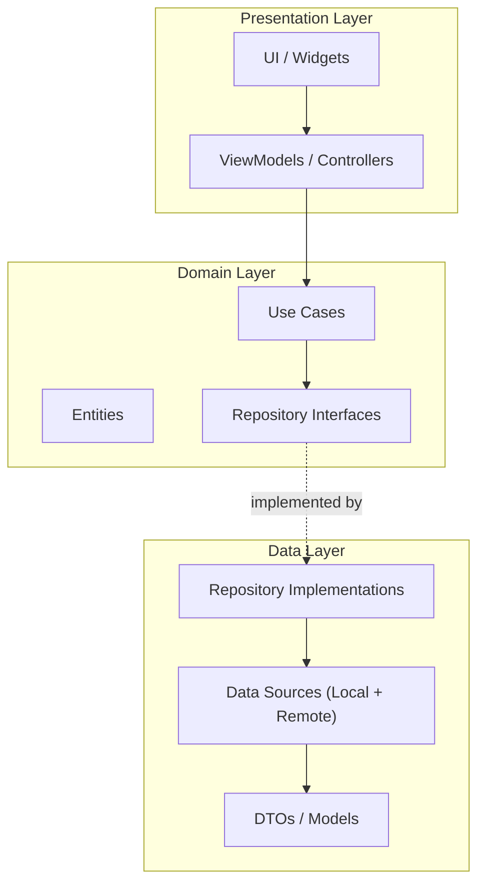
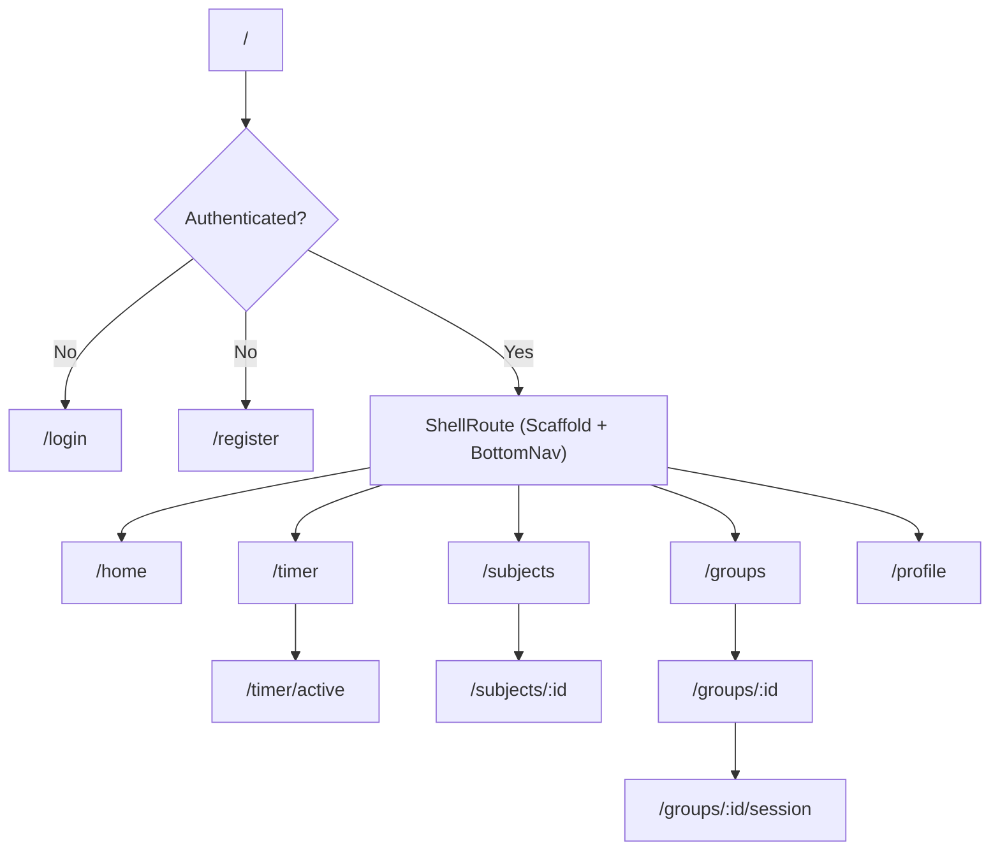
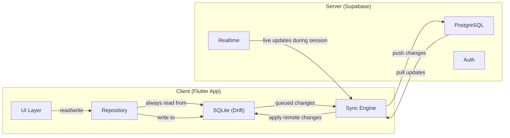
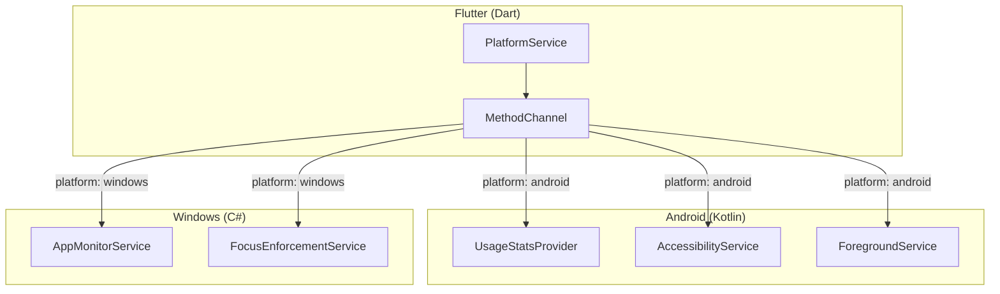
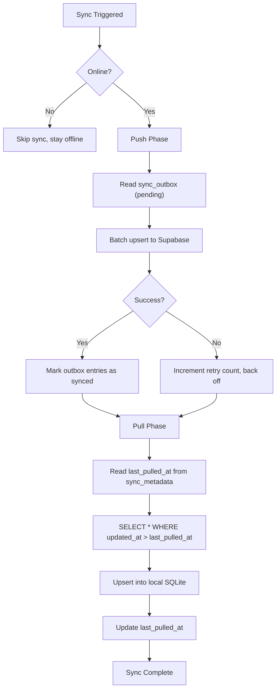
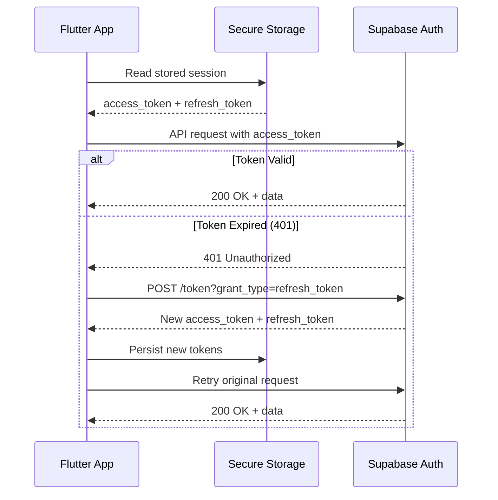
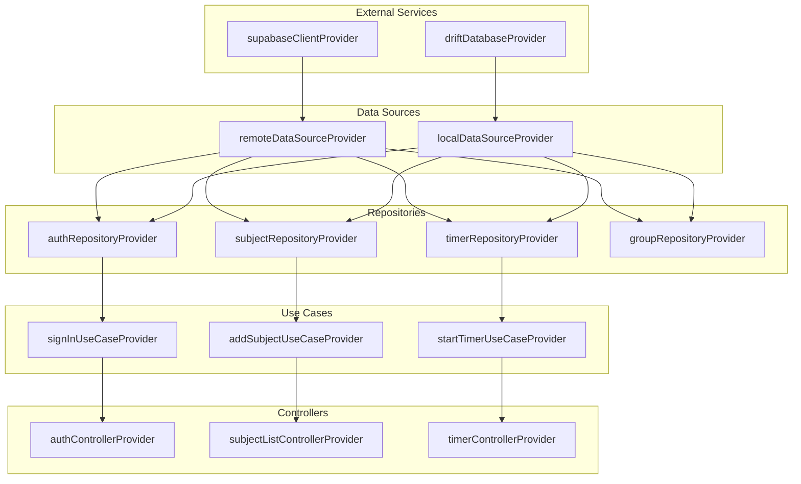

# LET'S FLY TGR — Architecture Document

> **Version:** 1.0.0  
> **Last Updated:** 2026-11-21  
> **Status:** Living Document

---

## Table of Contents

- [1. High-Level Architecture](#1-high-level-architecture)
- [2. State Management](#2-state-management)
- [3. Navigation](#3-navigation)
- [4. Data Flow](#4-data-flow)
- [5. Folder Structure](#5-folder-structure)
- [6. Platform Integration](#6-platform-integration)
- [7. Database Architecture](#7-database-architecture)
- [8. Security Architecture](#8-security-architecture)
- [9. Dependency Injection](#9-dependency-injection)

---

## 1. High-Level Architecture

The project follows **Clean Architecture** principles, separating concerns into three distinct layers. Each layer has a single responsibility and communicates with adjacent layers through well-defined interfaces. Dependencies point **inward** — outer layers depend on inner layers, never the reverse.



### 1.1 Presentation Layer

| Component | Responsibility |
|---|---|
| **Widgets / Pages** | Stateless or ConsumerWidget trees that render UI from provider state. No business logic. |
| **ViewModels / Controllers** | Riverpod `Notifier`, `AsyncNotifier`, or `StateNotifier` classes that orchestrate use cases, expose UI-ready state, and handle user interactions. |

**Rules:**
- Widgets never import from `data/`.
- Widgets access state exclusively through Riverpod providers.
- All user actions flow through the ViewModel; widgets do not call use cases directly.

### 1.2 Domain Layer

| Component | Responsibility |
|---|---|
| **Entities** | Pure Dart classes representing core business objects (e.g., `StudySession`, `Subject`, `Group`). Immutable, framework-agnostic. |
| **Use Cases** | Single-responsibility classes encapsulating one business operation (e.g., `StartTimerUseCase`, `JoinGroupUseCase`). Each exposes a `call()` method. |
| **Repository Interfaces** | Abstract classes defining the data contract the domain expects. No implementation details leak into this layer. |

**Rules:**
- Zero dependency on Flutter, Riverpod, Drift, or Supabase.
- Entities use `freezed` for immutability and union types.
- Use cases accept repository interfaces via constructor injection.

### 1.3 Data Layer

| Component | Responsibility |
|---|---|
| **Repository Implementations** | Concrete classes implementing domain repository interfaces. Coordinate between local and remote data sources, apply caching strategy, and handle sync. |
| **Data Sources** | `LocalDataSource` (Drift/SQLite) and `RemoteDataSource` (Supabase). Each is a thin wrapper over the underlying SDK. |
| **DTOs** | Data Transfer Objects for serialization/deserialization. Map to/from domain entities. Never used in the domain or presentation layer. |

**Rules:**
- DTOs are annotated with `json_serializable` or `freezed` for JSON mapping.
- Repositories decide whether to serve data from cache or network (offline-first).
- Data source errors are caught and mapped to domain-level `Failure` types.

---

## 2. State Management

**Riverpod** (with `riverpod_generator` code generation) is the sole state management and dependency injection solution.

### 2.1 Provider Organization

Providers are co-located with their feature:

```
lib/features/timer/
  presentation/
    providers/
      timer_controller.dart        # @riverpod AsyncNotifier
      timer_settings_provider.dart  # @riverpod simple provider
```

| Provider Kind | When to Use |
|---|---|
| `@riverpod` (generated, auto-dispose) | Default for all new providers. Lightweight, testable, automatically disposed when no longer listened to. |
| `@Riverpod(keepAlive: true)` | For state that must survive navigation (e.g., auth state, active timer session). |
| `StreamProvider` | Realtime data from Supabase subscriptions or Drift watch queries. |

### 2.2 AsyncNotifier Pattern

Used for all asynchronous operations — network calls, database queries, and sync workflows.

```dart
@riverpod
class SubjectList extends _$SubjectList {
  @override
  Future<List<Subject>> build() async {
    final repo = ref.watch(subjectRepositoryProvider);
    return repo.getAllSubjects();
  }

  Future<void> addSubject(String name) async {
    state = const AsyncLoading();
    state = await AsyncValue.guard(() async {
      await ref.read(addSubjectUseCaseProvider).call(name);
      return ref.read(subjectRepositoryProvider).getAllSubjects();
    });
  }
}
```

**Benefits:**
- Built-in `AsyncLoading`, `AsyncData`, `AsyncError` states eliminate manual loading/error booleans.
- `AsyncValue.guard` provides uniform error handling.
- `ref.invalidateSelf()` triggers a clean rebuild from `build()`.

### 2.3 StateNotifier for Complex State

Reserved for state machines with many transitions (e.g., the focus timer):

```dart
@freezed
class TimerState with _$TimerState {
  const factory TimerState.idle() = _Idle;
  const factory TimerState.running({required Duration elapsed, required Duration target}) = _Running;
  const factory TimerState.paused({required Duration elapsed, required Duration target}) = _Paused;
  const factory TimerState.completed({required Duration total}) = _Completed;
}
```

A `Notifier<TimerState>` manages transitions between these states, enforcing valid moves (e.g., `paused → running` is valid, `idle → paused` is not).

---

## 3. Navigation

**GoRouter** handles all navigation with declarative route configuration.

### 3.1 Route Architecture



### 3.2 Shell Routes

A `ShellRoute` wraps the authenticated portion of the app with a persistent scaffold containing bottom navigation (mobile) or side navigation (tablet/desktop).

```dart
ShellRoute(
  builder: (context, state, child) => AppScaffold(child: child),
  routes: [
    GoRoute(path: '/home', ...),
    GoRoute(path: '/timer', ...),
    GoRoute(path: '/subjects', ...),
    GoRoute(path: '/groups', ...),
    GoRoute(path: '/profile', ...),
  ],
)
```

### 3.3 Auth-Aware Redirects

A global `redirect` callback checks auth state on every navigation event:

```dart
redirect: (context, state) {
  final isLoggedIn = ref.read(authStateProvider).isAuthenticated;
  final isAuthRoute = state.matchedLocation.startsWith('/login') ||
                      state.matchedLocation.startsWith('/register');

  if (!isLoggedIn && !isAuthRoute) return '/login';
  if (isLoggedIn && isAuthRoute) return '/home';
  return null; // no redirect
}
```

A `Listenable` backed by the `authStateProvider` triggers `GoRouter` to re-evaluate redirects when auth state changes (e.g., token expiry, sign-out).

### 3.4 Deep Linking

- All routes use path-based URLs (no query parameters for core navigation).
- `GoRoute.path` patterns like `/groups/:id/session` support deep links from push notifications and shared URLs.
- Android `intent-filter` and Windows protocol handler are configured to intercept `letsflytrg://` scheme links.

---

## 4. Data Flow

### 4.1 Offline-First Architecture



**Core Principle:** The local SQLite database is the **single source of truth** for the UI. The network layer is a sync mechanism, not a primary data source.

### 4.2 Read Path

1. UI reads from a Riverpod provider.
2. Provider calls a use case.
3. Use case calls the repository interface.
4. Repository implementation reads from the local Drift database.
5. Drift returns a reactive `Stream<List<T>>` or a `Future<T>`.
6. The sync engine periodically pulls remote updates into the local database, which triggers reactive UI updates automatically.

### 4.3 Write Path

1. User action triggers a ViewModel method.
2. ViewModel calls a use case.
3. Use case calls the repository.
4. Repository writes to the local Drift database immediately (optimistic write).
5. The write is enqueued in the **sync outbox** table with a `pending` status.
6. The sync engine picks up pending changes and pushes them to Supabase.
7. On success, the outbox entry is marked `synced`. On failure, it remains `pending` for retry.

### 4.4 Realtime Subscriptions

For active group study sessions, the app subscribes to Supabase Realtime channels:

```dart
supabase.channel('group_session:$groupId')
  .onPostgresChanges(
    event: PostgresChangeEvent.all,
    schema: 'public',
    table: 'session_participants',
    filter: PostgresChangeFilter(type: PostgresChangeFilterType.eq, column: 'group_id', value: groupId),
    callback: (payload) => _handleRealtimeUpdate(payload),
  )
  .subscribe();
```

Realtime is used **only** for ephemeral, latency-sensitive data (live session status, participant presence). Persistent data always flows through the sync engine.

### 4.5 Conflict Resolution — Server-Authoritative

| Scenario | Resolution |
|---|---|
| **Same field, different values** | Server value wins. Client value is overwritten on next pull. |
| **Client creates, server deletes** | Deletion wins. Client record is removed on sync. |
| **Client deletes, server updates** | Deletion wins. The delete propagates to the server. |
| **Concurrent creates (same logical entity)** | Server-side unique constraints reject the duplicate. Client retries with the server's canonical record. |

Each synced table has an `updated_at` timestamp column. During pull, the sync engine compares `updated_at` values:

```
if remote.updated_at > local.updated_at → apply remote
if remote.updated_at <= local.updated_at → skip (local change pending push)
```

After a successful push, the server responds with the canonical `updated_at`, which the client stores locally.

---

## 5. Folder Structure

The project uses a **feature-first** organization. Shared infrastructure lives in `core/` and `shared/`.

```
lib/
├── app.dart                          # MaterialApp.router widget
├── main.dart                         # Entry point, ProviderScope, initialization
│
├── core/
│   ├── theme/
│   │   ├── app_theme.dart            # ThemeData definitions
│   │   ├── app_colors.dart           # Color constants
│   │   └── app_typography.dart       # TextStyle definitions
│   ├── constants/
│   │   ├── api_constants.dart        # Supabase URLs, table names
│   │   └── app_constants.dart        # Timeouts, limits, defaults
│   ├── utils/
│   │   ├── date_utils.dart
│   │   ├── string_utils.dart
│   │   └── logger.dart               # Structured logging
│   ├── extensions/
│   │   ├── context_extensions.dart    # BuildContext helpers
│   │   ├── datetime_extensions.dart
│   │   └── string_extensions.dart
│   └── errors/
│       ├── failures.dart             # Failure sealed class hierarchy
│       ├── exceptions.dart           # Custom exceptions
│       └── error_handler.dart        # Global error mapping
│
├── features/
│   ├── auth/
│   │   ├── data/
│   │   │   ├── datasources/
│   │   │   │   ├── auth_remote_datasource.dart
│   │   │   │   └── auth_local_datasource.dart
│   │   │   ├── models/
│   │   │   │   └── user_dto.dart
│   │   │   └── repositories/
│   │   │       └── auth_repository_impl.dart
│   │   ├── domain/
│   │   │   ├── entities/
│   │   │   │   └── app_user.dart
│   │   │   ├── repositories/
│   │   │   │   └── auth_repository.dart
│   │   │   └── usecases/
│   │   │       ├── sign_in_usecase.dart
│   │   │       ├── sign_up_usecase.dart
│   │   │       └── sign_out_usecase.dart
│   │   └── presentation/
│   │       ├── providers/
│   │       │   └── auth_controller.dart
│   │       ├── pages/
│   │       │   ├── login_page.dart
│   │       │   └── register_page.dart
│   │       └── widgets/
│   │           └── auth_form.dart
│   │
│   ├── timer/
│   │   ├── data/
│   │   ├── domain/
│   │   └── presentation/
│   │
│   ├── subjects/
│   │   ├── data/
│   │   ├── domain/
│   │   └── presentation/
│   │
│   ├── groups/
│   │   ├── data/
│   │   ├── domain/
│   │   └── presentation/
│   │
│   ├── analytics/
│   │   ├── data/
│   │   ├── domain/
│   │   └── presentation/
│   │
│   ├── focus_mode/
│   │   ├── data/
│   │   ├── domain/
│   │   └── presentation/
│   │
│   └── settings/
│       ├── data/
│       ├── domain/
│       └── presentation/
│
├── shared/
│   ├── widgets/
│   │   ├── app_button.dart
│   │   ├── app_text_field.dart
│   │   ├── loading_indicator.dart
│   │   └── error_widget.dart
│   ├── services/
│   │   ├── notification_service.dart
│   │   ├── connectivity_service.dart
│   │   └── platform_service.dart       # Abstracts platform channels
│   └── providers/
│       └── connectivity_provider.dart
│
└── routing/
    ├── app_router.dart               # GoRouter configuration
    ├── route_names.dart              # Named route constants
    └── route_guards.dart             # Redirect logic
```

### Key Conventions

| Convention | Rule |
|---|---|
| **File naming** | `snake_case.dart` |
| **One public class per file** | Enforced by linter |
| **Feature isolation** | Features never import directly from another feature's `data/` or `presentation/`. Cross-feature communication goes through `domain/` entities and shared providers. |
| **Barrel exports** | Each feature has a single `feature_name.dart` barrel file exporting its public API (domain entities, providers). |

---

## 6. Platform Integration

### 6.1 System Architecture — Platform Channels



### 6.2 Android — Kotlin

| Component | Purpose | Android API |
|---|---|---|
| **UsageStatsProvider** | Queries app usage data to calculate screen time, most-used apps, and study-vs-distraction ratios. | `UsageStatsManager` (requires `PACKAGE_USAGE_STATS` permission granted via Settings). |
| **AccessibilityService** | Detects when a blocked app is opened during focus mode and overlays a "return to study" prompt. | `AccessibilityService` with `TYPE_WINDOW_STATE_CHANGED` event filter. |
| **ForegroundService** | Keeps the timer alive when the app is backgrounded. Displays a persistent notification with elapsed time. | `Service.startForeground()` with `FOREGROUND_SERVICE_SPECIAL_USE` type. |

**Data flow:** Kotlin services communicate with Dart via `MethodChannel('com.letsflytrg/platform')` using JSON-serialized payloads.

### 6.3 Windows — C# Helper Service

| Component | Purpose | Windows API |
|---|---|---|
| **AppMonitorService** | Polls the foreground window to detect which application is active. Reports app switches to the Flutter layer. | `GetForegroundWindow()`, `GetWindowThreadProcessId()`, `Process.GetProcessById()`. |
| **FocusEnforcementService** | During focus mode, minimizes or hides blocked applications when they gain focus. | `ShowWindow(hWnd, SW_MINIMIZE)`, window hooks via `SetWinEventHook`. |

**Communication:** A named pipe (`\\.\pipe\LetsFlyTGR`) connects the C# background service to the Flutter app. The Flutter side uses `dart:io` `Socket` to read/write messages in a simple JSON-line protocol.

---

## 7. Database Architecture

### 7.1 Local Database — SQLite via Drift

Drift provides type-safe, reactive access to SQLite. Schema is defined in Dart, and queries are verified at compile time.

**Key tables:**

| Table | Description |
|---|---|
| `users` | Cached user profile |
| `subjects` | Study subjects/topics |
| `study_sessions` | Timer session records |
| `groups` | Study groups |
| `group_members` | Group membership |
| `blocked_apps` | Apps blocked during focus mode |
| `sync_outbox` | Pending changes to push to server |
| `sync_metadata` | Last sync timestamps per table |

**Reactive queries:**

```dart
// Returns a live stream that emits whenever the subjects table changes
Stream<List<Subject>> watchAllSubjects() {
  return (select(subjects)..orderBy([(t) => OrderingTerm.asc(t.name)])).watch();
}
```

### 7.2 Remote Database — Supabase PostgreSQL

Supabase hosts the canonical PostgreSQL database. Schema mirrors the local database with additional server-side columns:

| Column | Purpose |
|---|---|
| `id` | UUID primary key (generated client-side for offline support) |
| `created_at` | Server-set timestamp |
| `updated_at` | Trigger-updated on every modification |
| `deleted_at` | Soft-delete timestamp (nullable) |
| `user_id` | Foreign key to `auth.users`, used by RLS policies |

### 7.3 Sync Engine Design



**Sync triggers:**
- App foreground (lifecycle event)
- After every local write (debounced, 5-second window)
- Periodic background sync (every 15 minutes when app is active)
- Manual pull-to-refresh

**Sync guarantees:**
- **Idempotent:** Replaying the same sync is safe (upsert semantics).
- **Incremental:** Only changed rows since `last_pulled_at` are fetched.
- **Ordered:** Push always runs before pull to minimize conflicts.
- **Resilient:** Failed pushes remain in the outbox with exponential backoff (max 5 retries, then flagged for manual resolution).

---

## 8. Security Architecture

### 8.1 Row-Level Security (RLS)

Every user-facing table in Supabase has RLS enabled. Policies ensure users can only access their own data:

```sql
-- Example: users can only read/write their own subjects
CREATE POLICY "Users manage own subjects"
  ON public.subjects
  FOR ALL
  USING (auth.uid() = user_id)
  WITH CHECK (auth.uid() = user_id);

-- Example: group members can read group data
CREATE POLICY "Members read group"
  ON public.groups
  FOR SELECT
  USING (
    EXISTS (
      SELECT 1 FROM public.group_members
      WHERE group_members.group_id = groups.id
        AND group_members.user_id = auth.uid()
    )
  );
```

**RLS rules summary:**

| Table | SELECT | INSERT | UPDATE | DELETE |
|---|---|---|---|---|
| `subjects` | Own | Own | Own | Own |
| `study_sessions` | Own | Own | Own | Own |
| `groups` | Member | Any authed | Owner | Owner |
| `group_members` | Same group | Owner/self-join | Owner | Owner/self-leave |

### 8.2 API Key Management

| Key | Storage | Access |
|---|---|---|
| **Supabase Anon Key** | Compiled into the app (public, safe — RLS enforces access). | All client requests. |
| **Supabase Service Role Key** | **Never** in the client. Only in server-side Edge Functions. | Admin operations (user deletion, data migration). |

> [!CAUTION]
> The anon key is **not** a secret. It is safe to include in the client binary because RLS policies are the actual security boundary. The service role key bypasses RLS and must **never** be exposed.

### 8.3 Token Refresh



**Token storage:**
- **Android:** `flutter_secure_storage` → Android Keystore (AES-256).
- **Windows:** `flutter_secure_storage` → Windows Credential Manager (DPAPI).

**Session lifecycle:**
- Access tokens expire after 1 hour (Supabase default).
- The Supabase Dart client handles refresh automatically via `onAuthStateChange`.
- On refresh failure (e.g., refresh token revoked), the user is redirected to login.

---

## 9. Dependency Injection

All dependencies are provided through **Riverpod providers**, eliminating the need for a service locator like `get_it`.

### 9.1 Provider Hierarchy



### 9.2 Provider Registration Patterns

**External services** (keep alive, initialized once):

```dart
@Riverpod(keepAlive: true)
SupabaseClient supabaseClient(Ref ref) {
  return Supabase.instance.client;
}

@Riverpod(keepAlive: true)
AppDatabase driftDatabase(Ref ref) {
  return AppDatabase();
}
```

**Data sources** (keep alive, depend on external services):

```dart
@Riverpod(keepAlive: true)
AuthRemoteDataSource authRemoteDataSource(Ref ref) {
  return AuthRemoteDataSource(ref.watch(supabaseClientProvider));
}
```

**Repositories** (keep alive, implement domain interfaces):

```dart
@Riverpod(keepAlive: true)
AuthRepository authRepository(Ref ref) {
  return AuthRepositoryImpl(
    remote: ref.watch(authRemoteDataSourceProvider),
    local: ref.watch(authLocalDataSourceProvider),
  );
}
```

**Use cases** (auto-dispose, stateless):

```dart
@riverpod
SignInUseCase signInUseCase(Ref ref) {
  return SignInUseCase(ref.watch(authRepositoryProvider));
}
```

**Controllers** (auto-dispose by default, keep alive when noted):

```dart
@riverpod
class AuthController extends _$AuthController {
  @override
  Future<AppUser?> build() async {
    return ref.watch(authRepositoryProvider).getCurrentUser();
  }
}
```

### 9.3 Testing with Overrides

Riverpod's `ProviderContainer.overrides` enables clean test isolation without mocks leaking across tests:

```dart
final container = ProviderContainer(
  overrides: [
    authRepositoryProvider.overrideWithValue(MockAuthRepository()),
    driftDatabaseProvider.overrideWithValue(inMemoryTestDatabase()),
  ],
);
```

---

## Appendix: Key Dependencies

| Package | Purpose | Layer |
|---|---|---|
| `flutter_riverpod` + `riverpod_generator` | State management & DI | All |
| `freezed` + `json_serializable` | Immutable models, unions, JSON | Domain, Data |
| `go_router` | Declarative routing | Presentation |
| `drift` + `sqlite3_flutter_libs` | Local SQLite database | Data |
| `supabase_flutter` | Auth, Realtime, PostgreSQL client | Data |
| `flutter_secure_storage` | Secure token persistence | Data |
| `connectivity_plus` | Network state detection | Shared |
| `flutter_local_notifications` | Foreground service notifications | Shared |
