# 🐯 LET'S FLY TGR — Database Schema

> **Engine:** PostgreSQL 15+ (Supabase)
> **Auth:** Supabase Auth (`auth.users`)
> **Security:** Row Level Security (RLS) on every table
> **Last Updated:** 2026-11-21

---

## Table of Contents

1. [Entity Relationship Diagram](#entity-relationship-diagram)
2. [Extensions & Enums](#extensions--enums)
3. [Table Definitions](#table-definitions)
   - [profiles](#1-profiles)
   - [user_settings](#2-user_settings)
   - [devices](#3-devices)
   - [subjects](#4-subjects)
   - [study_sessions](#5-study_sessions)
   - [active_sessions](#6-active_sessions)
   - [groups](#7-groups)
   - [group_members](#8-group_members)
   - [group_invitations](#9-group_invitations)
   - [friendships](#10-friendships)
   - [achievements](#11-achievements)
   - [user_achievements](#12-user_achievements)
   - [study_goals](#13-study_goals)
   - [notifications](#14-notifications)
   - [app_blocking_rules](#15-app_blocking_rules)
   - [focus_schedules](#16-focus_schedules)
   - [pomodoro_settings](#17-pomodoro_settings)
   - [connected_integrations](#18-connected_integrations)
   - [ai_usage](#19-ai_usage)
   - [leaderboard_cache](#20-leaderboard_cache)
4. [Database Functions](#database-functions)
5. [Row Level Security Policies](#row-level-security-policies)
6. [Migration File Order](#migration-file-order)
7. [Seed Data — Achievements](#seed-data--achievements)

---

## Entity Relationship Diagram

```mermaid
erDiagram
    profiles ||--o{ subjects : "owns"
    profiles ||--o{ study_sessions : "records"
    profiles ||--o{ active_sessions : "runs"
    profiles ||--o{ devices : "registers"
    profiles ||--|| user_settings : "has"
    profiles ||--o{ study_goals : "sets"
    profiles ||--o{ notifications : "receives"
    profiles ||--o{ app_blocking_rules : "configures"
    profiles ||--o{ focus_schedules : "schedules"
    profiles ||--|| pomodoro_settings : "configures"
    profiles ||--o{ connected_integrations : "connects"
    profiles ||--o{ ai_usage : "tracks"
    profiles ||--o{ user_achievements : "earns"
    profiles ||--o{ friendships : "initiates"
    profiles ||--o{ leaderboard_cache : "cached_in"

    subjects ||--o{ study_sessions : "tracked_in"
    subjects ||--o{ active_sessions : "active_in"

    groups ||--o{ group_members : "has"
    groups ||--o{ group_invitations : "sends"
    profiles ||--o{ group_members : "joins"
    profiles ||--o{ group_invitations : "invited_to"

    achievements ||--o{ user_achievements : "unlocked_as"

    devices ||--o{ study_sessions : "recorded_on"
    devices ||--o{ active_sessions : "running_on"

    profiles {
        uuid id PK
        text username UK
        text display_name
        text avatar_url
        text bio
        text study_visibility
        timestamptz created_at
        timestamptz updated_at
    }

    user_settings {
        uuid id PK
        uuid user_id FK
        text theme
        jsonb notification_preferences
        jsonb privacy_settings
        text timezone
        text language
        boolean sounds_enabled
        boolean haptics_enabled
    }

    devices {
        uuid id PK
        uuid user_id FK
        text device_id UK
        text platform
        text device_name
        timestamptz last_active_at
        text push_token
        boolean is_active
    }

    subjects {
        uuid id PK
        uuid user_id FK
        text name
        text color
        text icon
        text category
        numeric target_hours_daily
        int sort_order
        boolean archived
    }

    study_sessions {
        uuid id PK
        uuid user_id FK
        uuid subject_id FK
        timestamptz started_at
        timestamptz ended_at
        int duration_seconds
        uuid device_id FK
        text session_type
        boolean is_verified
        text notes
    }

    active_sessions {
        uuid id PK
        uuid user_id FK
        uuid subject_id FK
        timestamptz started_at
        uuid device_id FK
        timestamptz last_heartbeat
        text status
        text session_type
    }

    groups {
        uuid id PK
        text name
        text description
        text avatar_url
        boolean is_private
        uuid owner_id FK
        int member_count
        text invite_code UK
        int max_members
    }

    group_members {
        uuid id PK
        uuid group_id FK
        uuid user_id FK
        text role
        timestamptz joined_at
    }

    group_invitations {
        uuid id PK
        uuid group_id FK
        uuid invited_user_id FK
        uuid invited_by FK
        text status
        timestamptz created_at
        timestamptz expires_at
    }

    friendships {
        uuid id PK
        uuid user_id FK
        uuid friend_id FK
        text status
        timestamptz created_at
        timestamptz updated_at
    }

    achievements {
        uuid id PK
        text name UK
        text description
        text icon
        text category
        text criteria_type
        numeric criteria_value
        int sort_order
    }

    user_achievements {
        uuid id PK
        uuid user_id FK
        uuid achievement_id FK
        timestamptz unlocked_at
        jsonb metadata
    }

    study_goals {
        uuid id PK
        uuid user_id FK
        text goal_type
        uuid subject_id FK
        int target_minutes
        date start_date
        date end_date
        boolean is_active
    }

    notifications {
        uuid id PK
        uuid user_id FK
        text type
        text title
        text body
        jsonb data
        boolean is_read
        timestamptz created_at
    }

    app_blocking_rules {
        uuid id PK
        uuid user_id FK
        text app_package_name
        text app_name
        boolean block_during_sessions
        boolean block_during_schedules
        boolean is_active
    }

    focus_schedules {
        uuid id PK
        uuid user_id FK
        text name
        int day_of_week
        time start_time
        time end_time
        boolean is_active
        boolean block_apps
        boolean block_notifications
    }

    pomodoro_settings {
        uuid id PK
        uuid user_id FK
        int work_duration_minutes
        int short_break_minutes
        int long_break_minutes
        int sessions_before_long_break
        boolean auto_start_breaks
        boolean auto_start_work
    }

    connected_integrations {
        uuid id PK
        uuid user_id FK
        text provider
        text external_id
        jsonb credentials_encrypted
        jsonb settings
        timestamptz connected_at
        timestamptz last_synced_at
        boolean is_active
    }

    ai_usage {
        uuid id PK
        uuid user_id FK
        text feature_name
        int tokens_used
        jsonb request_metadata
        timestamptz created_at
    }

    leaderboard_cache {
        uuid id PK
        uuid user_id FK
        text leaderboard_type
        text period
        date period_start
        int total_seconds
        int rank
        jsonb extra_stats
        timestamptz computed_at
    }
```



---

## Extensions & Enums

```sql
-- ============================================================
-- EXTENSIONS
-- ============================================================
CREATE EXTENSION IF NOT EXISTS "uuid-ossp";      -- uuid_generate_v4()
CREATE EXTENSION IF NOT EXISTS "pgcrypto";        -- gen_random_uuid()
CREATE EXTENSION IF NOT EXISTS "pg_trgm";         -- trigram fuzzy search


-- ============================================================
-- CUSTOM ENUM TYPES
-- ============================================================

CREATE TYPE study_visibility_enum AS ENUM (
  'public',        -- anyone can see study stats
  'friends_only',  -- only friends
  'private'        -- only the user
);

CREATE TYPE session_type_enum AS ENUM (
  'manual',        -- manually logged
  'timer',         -- standard timer
  'pomodoro',      -- pomodoro technique
  'stopwatch',     -- stopwatch mode
  'auto_detected'  -- detected via app usage
);

CREATE TYPE active_session_status_enum AS ENUM (
  'running',
  'paused',
  'heartbeat_lost'
);

CREATE TYPE group_role_enum AS ENUM (
  'owner',
  'admin',
  'moderator',
  'member'
);

CREATE TYPE invitation_status_enum AS ENUM (
  'pending',
  'accepted',
  'declined',
  'expired',
  'cancelled'
);

CREATE TYPE friendship_status_enum AS ENUM (
  'pending',
  'accepted',
  'declined',
  'blocked'
);

CREATE TYPE goal_type_enum AS ENUM (
  'daily',
  'weekly',
  'monthly',
  'custom'
);

CREATE TYPE notification_type_enum AS ENUM (
  'friend_request',
  'friend_accepted',
  'group_invite',
  'achievement_unlocked',
  'goal_completed',
  'streak_reminder',
  'session_reminder',
  'group_activity',
  'system',
  'ai_insight'
);

CREATE TYPE achievement_category_enum AS ENUM (
  'study_time',
  'streak',
  'social',
  'subject',
  'milestone',
  'special'
);

CREATE TYPE criteria_type_enum AS ENUM (
  'total_study_hours',
  'consecutive_days',
  'sessions_completed',
  'friends_count',
  'groups_joined',
  'subjects_created',
  'daily_goal_streak',
  'weekly_goal_streak',
  'single_session_hours',
  'total_sessions',
  'pomodoro_sessions',
  'early_bird_sessions',
  'night_owl_sessions'
);

CREATE TYPE leaderboard_type_enum AS ENUM (
  'global',
  'friends',
  'group'
);

CREATE TYPE leaderboard_period_enum AS ENUM (
  'daily',
  'weekly',
  'monthly',
  'all_time'
);

CREATE TYPE integration_provider_enum AS ENUM (
  'notion',
  'google_calendar',
  'apple_health',
  'todoist',
  'obsidian'
);

CREATE TYPE theme_enum AS ENUM (
  'system',
  'light',
  'dark',
  'tiger_orange',
  'midnight_blue'
);

CREATE TYPE device_platform_enum AS ENUM (
  'ios',
  'android',
  'web',
  'macos',
  'windows',
  'linux'
);
```

---

## Table Definitions

### 1. profiles

> Core user profile table. Every authenticated user gets a row automatically via trigger.

```sql
CREATE TABLE public.profiles (
  id              UUID        PRIMARY KEY REFERENCES auth.users(id) ON DELETE CASCADE,
  username        TEXT        UNIQUE NOT NULL,
  display_name    TEXT        NOT NULL DEFAULT '',
  avatar_url      TEXT,
  bio             TEXT        DEFAULT '' CHECK (char_length(bio) <= 500),
  study_visibility study_visibility_enum NOT NULL DEFAULT 'friends_only',
  streak_count    INT         NOT NULL DEFAULT 0 CHECK (streak_count >= 0),
  total_study_seconds BIGINT  NOT NULL DEFAULT 0 CHECK (total_study_seconds >= 0),
  created_at      TIMESTAMPTZ NOT NULL DEFAULT now(),
  updated_at      TIMESTAMPTZ NOT NULL DEFAULT now(),

  -- Username validation: 3-30 chars, lowercase alphanumeric + underscores
  CONSTRAINT username_format CHECK (
    username ~ '^[a-z0-9_]{3,30}$'
  ),
  -- Display name length
  CONSTRAINT display_name_length CHECK (
    char_length(display_name) <= 100
  )
);

-- Indexes
CREATE INDEX idx_profiles_username_trgm ON public.profiles
  USING gin (username gin_trgm_ops);

CREATE INDEX idx_profiles_display_name_trgm ON public.profiles
  USING gin (display_name gin_trgm_ops);

CREATE INDEX idx_profiles_created_at ON public.profiles (created_at DESC);

-- Trigger: auto-update updated_at
CREATE OR REPLACE FUNCTION public.handle_updated_at()
RETURNS TRIGGER AS $$
BEGIN
  NEW.updated_at = now();
  RETURN NEW;
END;
$$ LANGUAGE plpgsql;

CREATE TRIGGER set_profiles_updated_at
  BEFORE UPDATE ON public.profiles
  FOR EACH ROW EXECUTE FUNCTION public.handle_updated_at();

-- Trigger: auto-create profile on user signup
CREATE OR REPLACE FUNCTION public.handle_new_user()
RETURNS TRIGGER AS $$
BEGIN
  INSERT INTO public.profiles (id, username, display_name, avatar_url)
  VALUES (
    NEW.id,
    COALESCE(NEW.raw_user_meta_data->>'username', 'user_' || substr(NEW.id::text, 1, 8)),
    COALESCE(NEW.raw_user_meta_data->>'display_name', NEW.raw_user_meta_data->>'full_name', ''),
    COALESCE(NEW.raw_user_meta_data->>'avatar_url', '')
  );
  RETURN NEW;
END;
$$ LANGUAGE plpgsql SECURITY DEFINER;

CREATE TRIGGER on_auth_user_created
  AFTER INSERT ON auth.users
  FOR EACH ROW EXECUTE FUNCTION public.handle_new_user();
```

---

### 2. user_settings

> Per-user application settings. Created automatically with the profile.

```sql
CREATE TABLE public.user_settings (
  id                       UUID        PRIMARY KEY DEFAULT gen_random_uuid(),
  user_id                  UUID        UNIQUE NOT NULL REFERENCES public.profiles(id) ON DELETE CASCADE,
  theme                    theme_enum  NOT NULL DEFAULT 'system',
  notification_preferences JSONB       NOT NULL DEFAULT '{
    "push_enabled": true,
    "email_enabled": false,
    "session_reminders": true,
    "friend_requests": true,
    "group_activity": true,
    "achievements": true,
    "goal_reminders": true,
    "weekly_report": true
  }'::jsonb,
  privacy_settings         JSONB       NOT NULL DEFAULT '{
    "show_online_status": true,
    "show_current_session": true,
    "allow_friend_requests": true,
    "show_in_leaderboards": true,
    "show_study_stats": true
  }'::jsonb,
  timezone                 TEXT        NOT NULL DEFAULT 'UTC'
                                       CHECK (char_length(timezone) <= 50),
  language                 TEXT        NOT NULL DEFAULT 'en'
                                       CHECK (language ~ '^[a-z]{2}(-[A-Z]{2})?$'),
  sounds_enabled           BOOLEAN     NOT NULL DEFAULT true,
  haptics_enabled          BOOLEAN     NOT NULL DEFAULT true,
  daily_reminder_time      TIME,
  week_start_day           INT         NOT NULL DEFAULT 1 CHECK (week_start_day BETWEEN 0 AND 6),
  created_at               TIMESTAMPTZ NOT NULL DEFAULT now(),
  updated_at               TIMESTAMPTZ NOT NULL DEFAULT now()
);

-- Indexes
CREATE INDEX idx_user_settings_user_id ON public.user_settings (user_id);

-- Trigger
CREATE TRIGGER set_user_settings_updated_at
  BEFORE UPDATE ON public.user_settings
  FOR EACH ROW EXECUTE FUNCTION public.handle_updated_at();

-- Auto-create settings when profile is created
CREATE OR REPLACE FUNCTION public.handle_new_profile_settings()
RETURNS TRIGGER AS $$
BEGIN
  INSERT INTO public.user_settings (user_id)
  VALUES (NEW.id);
  RETURN NEW;
END;
$$ LANGUAGE plpgsql SECURITY DEFINER;

CREATE TRIGGER on_profile_created_settings
  AFTER INSERT ON public.profiles
  FOR EACH ROW EXECUTE FUNCTION public.handle_new_profile_settings();
```

---

### 3. devices

> Registered devices for multi-device sync and push notifications.

```sql
CREATE TABLE public.devices (
  id             UUID              PRIMARY KEY DEFAULT gen_random_uuid(),
  user_id        UUID              NOT NULL REFERENCES public.profiles(id) ON DELETE CASCADE,
  device_id      TEXT              NOT NULL,
  platform       device_platform_enum NOT NULL,
  device_name    TEXT              NOT NULL DEFAULT 'Unknown Device'
                                   CHECK (char_length(device_name) <= 100),
  last_active_at TIMESTAMPTZ       NOT NULL DEFAULT now(),
  push_token     TEXT,
  is_active      BOOLEAN           NOT NULL DEFAULT true,
  app_version    TEXT,
  created_at     TIMESTAMPTZ       NOT NULL DEFAULT now(),

  -- Each physical device registered once per user
  CONSTRAINT uq_devices_user_device UNIQUE (user_id, device_id)
);

-- Indexes
CREATE INDEX idx_devices_user_id ON public.devices (user_id);
CREATE INDEX idx_devices_push_token ON public.devices (push_token)
  WHERE push_token IS NOT NULL AND is_active = true;
CREATE INDEX idx_devices_last_active ON public.devices (last_active_at DESC);
```

---

### 4. subjects

> Study subjects that a user tracks time against.

```sql
CREATE TABLE public.subjects (
  id                 UUID        PRIMARY KEY DEFAULT gen_random_uuid(),
  user_id            UUID        NOT NULL REFERENCES public.profiles(id) ON DELETE CASCADE,
  name               TEXT        NOT NULL CHECK (char_length(name) BETWEEN 1 AND 100),
  color              TEXT        NOT NULL DEFAULT '#FF6B00'
                                 CHECK (color ~ '^#[0-9A-Fa-f]{6}$'),
  icon               TEXT        NOT NULL DEFAULT '📚'
                                 CHECK (char_length(icon) <= 10),
  category           TEXT        DEFAULT 'general'
                                 CHECK (char_length(category) <= 50),
  target_hours_daily NUMERIC(4,2) DEFAULT 0
                                 CHECK (target_hours_daily >= 0 AND target_hours_daily <= 24),
  sort_order         INT         NOT NULL DEFAULT 0,
  archived           BOOLEAN     NOT NULL DEFAULT false,
  total_seconds      BIGINT      NOT NULL DEFAULT 0 CHECK (total_seconds >= 0),
  session_count      INT         NOT NULL DEFAULT 0 CHECK (session_count >= 0),
  created_at         TIMESTAMPTZ NOT NULL DEFAULT now(),
  updated_at         TIMESTAMPTZ NOT NULL DEFAULT now(),

  -- No duplicate active subject names per user
  CONSTRAINT uq_subjects_user_name UNIQUE (user_id, name)
);

-- Indexes
CREATE INDEX idx_subjects_user_id ON public.subjects (user_id);
CREATE INDEX idx_subjects_user_active ON public.subjects (user_id, sort_order)
  WHERE archived = false;
CREATE INDEX idx_subjects_category ON public.subjects (user_id, category);

-- Trigger
CREATE TRIGGER set_subjects_updated_at
  BEFORE UPDATE ON public.subjects
  FOR EACH ROW EXECUTE FUNCTION public.handle_updated_at();
```

---

### 5. study_sessions

> Completed study sessions. The core analytics table.

```sql
CREATE TABLE public.study_sessions (
  id               UUID              PRIMARY KEY DEFAULT gen_random_uuid(),
  user_id          UUID              NOT NULL REFERENCES public.profiles(id) ON DELETE CASCADE,
  subject_id       UUID              NOT NULL REFERENCES public.subjects(id) ON DELETE CASCADE,
  started_at       TIMESTAMPTZ       NOT NULL,
  ended_at         TIMESTAMPTZ       NOT NULL,
  duration_seconds INT               NOT NULL CHECK (duration_seconds > 0 AND duration_seconds <= 86400),
  device_id        UUID              REFERENCES public.devices(id) ON DELETE SET NULL,
  session_type     session_type_enum NOT NULL DEFAULT 'timer',
  is_verified      BOOLEAN           NOT NULL DEFAULT false,
  notes            TEXT              CHECK (char_length(notes) <= 1000),
  mood_rating      INT               CHECK (mood_rating BETWEEN 1 AND 5),
  focus_score      INT               CHECK (focus_score BETWEEN 0 AND 100),
  created_at       TIMESTAMPTZ       NOT NULL DEFAULT now(),

  -- End must be after start
  CONSTRAINT session_time_order CHECK (ended_at > started_at),
  -- Duration must roughly match the time range (±60s tolerance for clock drift)
  CONSTRAINT session_duration_match CHECK (
    ABS(duration_seconds - EXTRACT(EPOCH FROM (ended_at - started_at))::int) <= 60
  )
);

-- Indexes (critical for analytics queries)
CREATE INDEX idx_sessions_user_id ON public.study_sessions (user_id);
CREATE INDEX idx_sessions_user_started ON public.study_sessions (user_id, started_at DESC);
CREATE INDEX idx_sessions_user_subject ON public.study_sessions (user_id, subject_id);
CREATE INDEX idx_sessions_user_date ON public.study_sessions (user_id, (started_at::date));
CREATE INDEX idx_sessions_subject_id ON public.study_sessions (subject_id);
CREATE INDEX idx_sessions_started_at ON public.study_sessions (started_at DESC);
CREATE INDEX idx_sessions_created_at ON public.study_sessions (created_at DESC);

-- Composite index for daily aggregation queries
CREATE INDEX idx_sessions_user_day_duration ON public.study_sessions (
  user_id,
  (started_at::date),
  duration_seconds
);
```

---

### 6. active_sessions

> Currently running study sessions. Cleaned up when sessions end or heartbeat is lost.

```sql
CREATE TABLE public.active_sessions (
  id              UUID                     PRIMARY KEY DEFAULT gen_random_uuid(),
  user_id         UUID                     NOT NULL REFERENCES public.profiles(id) ON DELETE CASCADE,
  subject_id      UUID                     NOT NULL REFERENCES public.subjects(id) ON DELETE CASCADE,
  started_at      TIMESTAMPTZ              NOT NULL DEFAULT now(),
  device_id       UUID                     REFERENCES public.devices(id) ON DELETE SET NULL,
  last_heartbeat  TIMESTAMPTZ              NOT NULL DEFAULT now(),
  status          active_session_status_enum NOT NULL DEFAULT 'running',
  session_type    session_type_enum        NOT NULL DEFAULT 'timer',
  accumulated_seconds INT                  NOT NULL DEFAULT 0 CHECK (accumulated_seconds >= 0),
  created_at      TIMESTAMPTZ              NOT NULL DEFAULT now(),

  -- Only one active session per user at a time
  CONSTRAINT uq_active_session_user UNIQUE (user_id)
);

-- Indexes
CREATE INDEX idx_active_sessions_user_id ON public.active_sessions (user_id);
CREATE INDEX idx_active_sessions_heartbeat ON public.active_sessions (last_heartbeat)
  WHERE status = 'running';
CREATE INDEX idx_active_sessions_status ON public.active_sessions (status);
```

---

### 7. groups

> Study groups for collaborative studying.

```sql
CREATE TABLE public.groups (
  id           UUID        PRIMARY KEY DEFAULT gen_random_uuid(),
  name         TEXT        NOT NULL CHECK (char_length(name) BETWEEN 2 AND 100),
  description  TEXT        DEFAULT '' CHECK (char_length(description) <= 1000),
  avatar_url   TEXT,
  is_private   BOOLEAN     NOT NULL DEFAULT false,
  owner_id     UUID        NOT NULL REFERENCES public.profiles(id) ON DELETE CASCADE,
  member_count INT         NOT NULL DEFAULT 1 CHECK (member_count >= 0),
  invite_code  TEXT        UNIQUE NOT NULL DEFAULT encode(gen_random_bytes(6), 'hex'),
  max_members  INT         NOT NULL DEFAULT 50 CHECK (max_members BETWEEN 2 AND 500),
  category     TEXT        DEFAULT 'general' CHECK (char_length(category) <= 50),
  created_at   TIMESTAMPTZ NOT NULL DEFAULT now(),
  updated_at   TIMESTAMPTZ NOT NULL DEFAULT now(),

  -- Member count cannot exceed max
  CONSTRAINT member_count_within_max CHECK (member_count <= max_members)
);

-- Indexes
CREATE INDEX idx_groups_owner_id ON public.groups (owner_id);
CREATE INDEX idx_groups_invite_code ON public.groups (invite_code);
CREATE INDEX idx_groups_name_trgm ON public.groups USING gin (name gin_trgm_ops);
CREATE INDEX idx_groups_public ON public.groups (created_at DESC)
  WHERE is_private = false;

-- Trigger
CREATE TRIGGER set_groups_updated_at
  BEFORE UPDATE ON public.groups
  FOR EACH ROW EXECUTE FUNCTION public.handle_updated_at();
```

---

### 8. group_members

> Group membership junction table with roles.

```sql
CREATE TABLE public.group_members (
  id        UUID           PRIMARY KEY DEFAULT gen_random_uuid(),
  group_id  UUID           NOT NULL REFERENCES public.groups(id) ON DELETE CASCADE,
  user_id   UUID           NOT NULL REFERENCES public.profiles(id) ON DELETE CASCADE,
  role      group_role_enum NOT NULL DEFAULT 'member',
  joined_at TIMESTAMPTZ    NOT NULL DEFAULT now(),

  -- One membership per user per group
  CONSTRAINT uq_group_member UNIQUE (group_id, user_id)
);

-- Indexes
CREATE INDEX idx_group_members_group_id ON public.group_members (group_id);
CREATE INDEX idx_group_members_user_id ON public.group_members (user_id);
CREATE INDEX idx_group_members_role ON public.group_members (group_id, role);
```

---

### 9. group_invitations

> Pending group invitations with expiry.

```sql
CREATE TABLE public.group_invitations (
  id              UUID                  PRIMARY KEY DEFAULT gen_random_uuid(),
  group_id        UUID                  NOT NULL REFERENCES public.groups(id) ON DELETE CASCADE,
  invited_user_id UUID                  NOT NULL REFERENCES public.profiles(id) ON DELETE CASCADE,
  invited_by      UUID                  NOT NULL REFERENCES public.profiles(id) ON DELETE CASCADE,
  status          invitation_status_enum NOT NULL DEFAULT 'pending',
  message         TEXT                  CHECK (char_length(message) <= 500),
  created_at      TIMESTAMPTZ           NOT NULL DEFAULT now(),
  expires_at      TIMESTAMPTZ           NOT NULL DEFAULT (now() + INTERVAL '7 days'),
  responded_at    TIMESTAMPTZ,

  -- No duplicate pending invites for same user+group
  CONSTRAINT uq_pending_invite UNIQUE (group_id, invited_user_id, status),
  -- Expiry must be in the future relative to creation
  CONSTRAINT invitation_expiry_valid CHECK (expires_at > created_at)
);

-- Indexes
CREATE INDEX idx_group_invitations_user ON public.group_invitations (invited_user_id)
  WHERE status = 'pending';
CREATE INDEX idx_group_invitations_group ON public.group_invitations (group_id);
CREATE INDEX idx_group_invitations_expires ON public.group_invitations (expires_at)
  WHERE status = 'pending';
```

---

### 10. friendships

> Bidirectional friend connections with status tracking.

```sql
CREATE TABLE public.friendships (
  id         UUID                   PRIMARY KEY DEFAULT gen_random_uuid(),
  user_id    UUID                   NOT NULL REFERENCES public.profiles(id) ON DELETE CASCADE,
  friend_id  UUID                   NOT NULL REFERENCES public.profiles(id) ON DELETE CASCADE,
  status     friendship_status_enum NOT NULL DEFAULT 'pending',
  created_at TIMESTAMPTZ            NOT NULL DEFAULT now(),
  updated_at TIMESTAMPTZ            NOT NULL DEFAULT now(),

  -- Cannot friend yourself
  CONSTRAINT no_self_friendship CHECK (user_id != friend_id),
  -- One friendship record per pair (user_id < friend_id enforced by function)
  CONSTRAINT uq_friendship_pair UNIQUE (user_id, friend_id)
);

-- Indexes
CREATE INDEX idx_friendships_user ON public.friendships (user_id);
CREATE INDEX idx_friendships_friend ON public.friendships (friend_id);
CREATE INDEX idx_friendships_status ON public.friendships (status);
CREATE INDEX idx_friendships_accepted ON public.friendships (user_id, friend_id)
  WHERE status = 'accepted';

-- Trigger
CREATE TRIGGER set_friendships_updated_at
  BEFORE UPDATE ON public.friendships
  FOR EACH ROW EXECUTE FUNCTION public.handle_updated_at();
```

---

### 11. achievements

> Achievement definitions (system-managed, not user-created).

```sql
CREATE TABLE public.achievements (
  id             UUID                     PRIMARY KEY DEFAULT gen_random_uuid(),
  name           TEXT                     UNIQUE NOT NULL CHECK (char_length(name) BETWEEN 2 AND 100),
  description    TEXT                     NOT NULL CHECK (char_length(description) <= 500),
  icon           TEXT                     NOT NULL DEFAULT '🏆'
                                          CHECK (char_length(icon) <= 10),
  category       achievement_category_enum NOT NULL,
  criteria_type  criteria_type_enum       NOT NULL,
  criteria_value NUMERIC                  NOT NULL CHECK (criteria_value > 0),
  xp_reward      INT                     NOT NULL DEFAULT 0 CHECK (xp_reward >= 0),
  sort_order     INT                     NOT NULL DEFAULT 0,
  is_hidden      BOOLEAN                 NOT NULL DEFAULT false,
  created_at     TIMESTAMPTZ             NOT NULL DEFAULT now()
);

-- Indexes
CREATE INDEX idx_achievements_category ON public.achievements (category);
CREATE INDEX idx_achievements_criteria ON public.achievements (criteria_type, criteria_value);
CREATE INDEX idx_achievements_sort ON public.achievements (sort_order);
```

---

### 12. user_achievements

> Junction table: which users unlocked which achievements.

```sql
CREATE TABLE public.user_achievements (
  id             UUID        PRIMARY KEY DEFAULT gen_random_uuid(),
  user_id        UUID        NOT NULL REFERENCES public.profiles(id) ON DELETE CASCADE,
  achievement_id UUID        NOT NULL REFERENCES public.achievements(id) ON DELETE CASCADE,
  unlocked_at    TIMESTAMPTZ NOT NULL DEFAULT now(),
  metadata       JSONB       DEFAULT '{}'::jsonb,

  -- Each achievement unlocked only once per user
  CONSTRAINT uq_user_achievement UNIQUE (user_id, achievement_id)
);

-- Indexes
CREATE INDEX idx_user_achievements_user ON public.user_achievements (user_id);
CREATE INDEX idx_user_achievements_achievement ON public.user_achievements (achievement_id);
CREATE INDEX idx_user_achievements_unlocked ON public.user_achievements (unlocked_at DESC);
```

---

### 13. study_goals

> User-defined study goals with daily/weekly/monthly targets.

```sql
CREATE TABLE public.study_goals (
  id             UUID           PRIMARY KEY DEFAULT gen_random_uuid(),
  user_id        UUID           NOT NULL REFERENCES public.profiles(id) ON DELETE CASCADE,
  goal_type      goal_type_enum NOT NULL,
  subject_id     UUID           REFERENCES public.subjects(id) ON DELETE SET NULL,
  target_minutes INT            NOT NULL CHECK (target_minutes > 0 AND target_minutes <= 1440),
  start_date     DATE           NOT NULL DEFAULT CURRENT_DATE,
  end_date       DATE,
  is_active      BOOLEAN        NOT NULL DEFAULT true,
  current_streak INT            NOT NULL DEFAULT 0 CHECK (current_streak >= 0),
  best_streak    INT            NOT NULL DEFAULT 0 CHECK (best_streak >= 0),
  created_at     TIMESTAMPTZ    NOT NULL DEFAULT now(),
  updated_at     TIMESTAMPTZ    NOT NULL DEFAULT now(),

  -- End date must be after start date if set
  CONSTRAINT goal_date_order CHECK (end_date IS NULL OR end_date >= start_date),
  -- Only one active goal per type per subject per user
  CONSTRAINT uq_active_goal UNIQUE (user_id, goal_type, subject_id, is_active)
);

-- Indexes
CREATE INDEX idx_study_goals_user ON public.study_goals (user_id);
CREATE INDEX idx_study_goals_active ON public.study_goals (user_id, is_active)
  WHERE is_active = true;
CREATE INDEX idx_study_goals_type ON public.study_goals (user_id, goal_type);

-- Trigger
CREATE TRIGGER set_study_goals_updated_at
  BEFORE UPDATE ON public.study_goals
  FOR EACH ROW EXECUTE FUNCTION public.handle_updated_at();
```

---

### 14. notifications

> In-app notification records delivered to users.

```sql
CREATE TABLE public.notifications (
  id          UUID                  PRIMARY KEY DEFAULT gen_random_uuid(),
  user_id     UUID                  NOT NULL REFERENCES public.profiles(id) ON DELETE CASCADE,
  type        notification_type_enum NOT NULL,
  title       TEXT                  NOT NULL CHECK (char_length(title) <= 200),
  body        TEXT                  NOT NULL CHECK (char_length(body) <= 2000),
  data        JSONB                 DEFAULT '{}'::jsonb,
  is_read     BOOLEAN               NOT NULL DEFAULT false,
  action_url  TEXT,
  created_at  TIMESTAMPTZ           NOT NULL DEFAULT now(),
  read_at     TIMESTAMPTZ
);

-- Indexes
CREATE INDEX idx_notifications_user ON public.notifications (user_id, created_at DESC);
CREATE INDEX idx_notifications_unread ON public.notifications (user_id)
  WHERE is_read = false;
CREATE INDEX idx_notifications_type ON public.notifications (user_id, type);

-- Auto-cleanup: delete notifications older than 90 days (run via pg_cron)
-- SELECT cron.schedule('cleanup-old-notifications', '0 3 * * *',
--   $$DELETE FROM public.notifications WHERE created_at < now() - INTERVAL '90 days'$$
-- );
```

---

### 15. app_blocking_rules

> App blocking configurations for focus mode.

```sql
CREATE TABLE public.app_blocking_rules (
  id                     UUID        PRIMARY KEY DEFAULT gen_random_uuid(),
  user_id                UUID        NOT NULL REFERENCES public.profiles(id) ON DELETE CASCADE,
  app_package_name       TEXT        NOT NULL CHECK (char_length(app_package_name) <= 255),
  app_name               TEXT        NOT NULL CHECK (char_length(app_name) <= 100),
  block_during_sessions  BOOLEAN     NOT NULL DEFAULT true,
  block_during_schedules BOOLEAN     NOT NULL DEFAULT true,
  is_active              BOOLEAN     NOT NULL DEFAULT true,
  created_at             TIMESTAMPTZ NOT NULL DEFAULT now(),
  updated_at             TIMESTAMPTZ NOT NULL DEFAULT now(),

  -- No duplicate package names per user
  CONSTRAINT uq_blocking_rule UNIQUE (user_id, app_package_name)
);

-- Indexes
CREATE INDEX idx_blocking_rules_user ON public.app_blocking_rules (user_id);
CREATE INDEX idx_blocking_rules_active ON public.app_blocking_rules (user_id)
  WHERE is_active = true;

-- Trigger
CREATE TRIGGER set_blocking_rules_updated_at
  BEFORE UPDATE ON public.app_blocking_rules
  FOR EACH ROW EXECUTE FUNCTION public.handle_updated_at();
```

---

### 16. focus_schedules

> Scheduled focus/study times with per-day granularity.

```sql
CREATE TABLE public.focus_schedules (
  id                  UUID        PRIMARY KEY DEFAULT gen_random_uuid(),
  user_id             UUID        NOT NULL REFERENCES public.profiles(id) ON DELETE CASCADE,
  name                TEXT        NOT NULL CHECK (char_length(name) BETWEEN 1 AND 100),
  day_of_week         INT         NOT NULL CHECK (day_of_week BETWEEN 0 AND 6),
  start_time          TIME        NOT NULL,
  end_time            TIME        NOT NULL,
  is_active           BOOLEAN     NOT NULL DEFAULT true,
  block_apps          BOOLEAN     NOT NULL DEFAULT true,
  block_notifications BOOLEAN     NOT NULL DEFAULT false,
  subject_id          UUID        REFERENCES public.subjects(id) ON DELETE SET NULL,
  created_at          TIMESTAMPTZ NOT NULL DEFAULT now(),
  updated_at          TIMESTAMPTZ NOT NULL DEFAULT now(),

  -- End time must be after start time
  CONSTRAINT schedule_time_order CHECK (end_time > start_time),
  -- No overlapping schedules for same user on same day
  CONSTRAINT uq_focus_schedule_slot UNIQUE (user_id, day_of_week, start_time)
);

-- Indexes
CREATE INDEX idx_focus_schedules_user ON public.focus_schedules (user_id);
CREATE INDEX idx_focus_schedules_active ON public.focus_schedules (user_id, day_of_week)
  WHERE is_active = true;
CREATE INDEX idx_focus_schedules_day ON public.focus_schedules (day_of_week, start_time);

-- Trigger
CREATE TRIGGER set_focus_schedules_updated_at
  BEFORE UPDATE ON public.focus_schedules
  FOR EACH ROW EXECUTE FUNCTION public.handle_updated_at();
```

---

### 17. pomodoro_settings

> Per-user Pomodoro technique configuration.

```sql
CREATE TABLE public.pomodoro_settings (
  id                        UUID        PRIMARY KEY DEFAULT gen_random_uuid(),
  user_id                   UUID        UNIQUE NOT NULL REFERENCES public.profiles(id) ON DELETE CASCADE,
  work_duration_minutes     INT         NOT NULL DEFAULT 25
                                        CHECK (work_duration_minutes BETWEEN 1 AND 120),
  short_break_minutes       INT         NOT NULL DEFAULT 5
                                        CHECK (short_break_minutes BETWEEN 1 AND 60),
  long_break_minutes        INT         NOT NULL DEFAULT 15
                                        CHECK (long_break_minutes BETWEEN 1 AND 120),
  sessions_before_long_break INT        NOT NULL DEFAULT 4
                                        CHECK (sessions_before_long_break BETWEEN 1 AND 12),
  auto_start_breaks         BOOLEAN     NOT NULL DEFAULT false,
  auto_start_work           BOOLEAN     NOT NULL DEFAULT false,
  sound_on_complete         TEXT        DEFAULT 'default'
                                        CHECK (char_length(sound_on_complete) <= 50),
  vibrate_on_complete       BOOLEAN     NOT NULL DEFAULT true,
  created_at                TIMESTAMPTZ NOT NULL DEFAULT now(),
  updated_at                TIMESTAMPTZ NOT NULL DEFAULT now()
);

-- Trigger
CREATE TRIGGER set_pomodoro_settings_updated_at
  BEFORE UPDATE ON public.pomodoro_settings
  FOR EACH ROW EXECUTE FUNCTION public.handle_updated_at();

-- Auto-create pomodoro settings when profile is created
CREATE OR REPLACE FUNCTION public.handle_new_profile_pomodoro()
RETURNS TRIGGER AS $$
BEGIN
  INSERT INTO public.pomodoro_settings (user_id)
  VALUES (NEW.id);
  RETURN NEW;
END;
$$ LANGUAGE plpgsql SECURITY DEFINER;

CREATE TRIGGER on_profile_created_pomodoro
  AFTER INSERT ON public.profiles
  FOR EACH ROW EXECUTE FUNCTION public.handle_new_profile_pomodoro();
```

---

### 18. connected_integrations

> Third-party service connections (Notion, Google Calendar, etc.).

```sql
CREATE TABLE public.connected_integrations (
  id                    UUID                     PRIMARY KEY DEFAULT gen_random_uuid(),
  user_id               UUID                     NOT NULL REFERENCES public.profiles(id) ON DELETE CASCADE,
  provider              integration_provider_enum NOT NULL,
  external_id           TEXT,
  credentials_encrypted JSONB                    DEFAULT '{}'::jsonb,
  settings              JSONB                    DEFAULT '{}'::jsonb,
  connected_at          TIMESTAMPTZ              NOT NULL DEFAULT now(),
  last_synced_at        TIMESTAMPTZ,
  is_active             BOOLEAN                  NOT NULL DEFAULT true,
  sync_error            TEXT,
  created_at            TIMESTAMPTZ              NOT NULL DEFAULT now(),
  updated_at            TIMESTAMPTZ              NOT NULL DEFAULT now(),

  -- One connection per provider per user
  CONSTRAINT uq_integration_user_provider UNIQUE (user_id, provider)
);

-- Indexes
CREATE INDEX idx_integrations_user ON public.connected_integrations (user_id);
CREATE INDEX idx_integrations_active ON public.connected_integrations (user_id)
  WHERE is_active = true;
CREATE INDEX idx_integrations_provider ON public.connected_integrations (provider);

-- Trigger
CREATE TRIGGER set_integrations_updated_at
  BEFORE UPDATE ON public.connected_integrations
  FOR EACH ROW EXECUTE FUNCTION public.handle_updated_at();
```

---

### 19. ai_usage

> Tracks AI feature usage for rate limiting and analytics.

```sql
CREATE TABLE public.ai_usage (
  id               UUID        PRIMARY KEY DEFAULT gen_random_uuid(),
  user_id          UUID        NOT NULL REFERENCES public.profiles(id) ON DELETE CASCADE,
  feature_name     TEXT        NOT NULL CHECK (char_length(feature_name) <= 100),
  tokens_used      INT         NOT NULL DEFAULT 0 CHECK (tokens_used >= 0),
  request_metadata JSONB       DEFAULT '{}'::jsonb,
  model_used       TEXT        CHECK (char_length(model_used) <= 100),
  response_time_ms INT         CHECK (response_time_ms >= 0),
  was_successful   BOOLEAN     NOT NULL DEFAULT true,
  created_at       TIMESTAMPTZ NOT NULL DEFAULT now()
);

-- Indexes
CREATE INDEX idx_ai_usage_user ON public.ai_usage (user_id);
CREATE INDEX idx_ai_usage_user_date ON public.ai_usage (user_id, created_at::date);
CREATE INDEX idx_ai_usage_feature ON public.ai_usage (feature_name);
CREATE INDEX idx_ai_usage_created ON public.ai_usage (created_at DESC);

-- Composite index for rate-limiting queries (tokens used today)
CREATE INDEX idx_ai_usage_rate_limit ON public.ai_usage (
  user_id,
  created_at DESC,
  tokens_used
);
```

---

### 20. leaderboard_cache

> Materialized leaderboard data, refreshed periodically.

```sql
CREATE TABLE public.leaderboard_cache (
  id               UUID                    PRIMARY KEY DEFAULT gen_random_uuid(),
  user_id          UUID                    NOT NULL REFERENCES public.profiles(id) ON DELETE CASCADE,
  leaderboard_type leaderboard_type_enum   NOT NULL DEFAULT 'global',
  period           leaderboard_period_enum NOT NULL,
  period_start     DATE                    NOT NULL,
  total_seconds    BIGINT                  NOT NULL DEFAULT 0 CHECK (total_seconds >= 0),
  session_count    INT                     NOT NULL DEFAULT 0 CHECK (session_count >= 0),
  rank             INT                     NOT NULL DEFAULT 0 CHECK (rank >= 0),
  extra_stats      JSONB                   DEFAULT '{}'::jsonb,
  reference_id     UUID,                   -- group_id for group leaderboards, NULL for global/friends
  computed_at      TIMESTAMPTZ             NOT NULL DEFAULT now(),

  -- One entry per user per leaderboard per period
  CONSTRAINT uq_leaderboard_entry UNIQUE (user_id, leaderboard_type, period, period_start, reference_id)
);

-- Indexes
CREATE INDEX idx_leaderboard_lookup ON public.leaderboard_cache (
  leaderboard_type, period, period_start, rank
);
CREATE INDEX idx_leaderboard_user ON public.leaderboard_cache (user_id);
CREATE INDEX idx_leaderboard_computed ON public.leaderboard_cache (computed_at);
CREATE INDEX idx_leaderboard_reference ON public.leaderboard_cache (reference_id)
  WHERE reference_id IS NOT NULL;
```

---

## Database Functions

### Study Session Completion

```sql
-- Complete an active session and move it to study_sessions
CREATE OR REPLACE FUNCTION public.complete_study_session(
  p_user_id UUID,
  p_notes TEXT DEFAULT NULL,
  p_mood_rating INT DEFAULT NULL,
  p_focus_score INT DEFAULT NULL
)
RETURNS UUID AS $$
DECLARE
  v_active    RECORD;
  v_session_id UUID;
  v_duration  INT;
BEGIN
  -- Get and lock the active session
  SELECT * INTO v_active
  FROM public.active_sessions
  WHERE user_id = p_user_id
  FOR UPDATE;

  IF NOT FOUND THEN
    RAISE EXCEPTION 'No active session found for user %', p_user_id;
  END IF;

  -- Calculate duration
  v_duration := v_active.accumulated_seconds
    + EXTRACT(EPOCH FROM (now() - v_active.started_at))::int;

  -- Clamp to max 24 hours
  IF v_duration > 86400 THEN
    v_duration := 86400;
  END IF;

  -- Insert into completed sessions
  INSERT INTO public.study_sessions (
    user_id, subject_id, started_at, ended_at,
    duration_seconds, device_id, session_type,
    is_verified, notes, mood_rating, focus_score
  ) VALUES (
    v_active.user_id, v_active.subject_id, v_active.started_at, now(),
    v_duration, v_active.device_id, v_active.session_type,
    true, p_notes, p_mood_rating, p_focus_score
  ) RETURNING id INTO v_session_id;

  -- Update subject totals
  UPDATE public.subjects
  SET total_seconds = total_seconds + v_duration,
      session_count = session_count + 1
  WHERE id = v_active.subject_id;

  -- Update profile totals
  UPDATE public.profiles
  SET total_study_seconds = total_study_seconds + v_duration
  WHERE id = p_user_id;

  -- Delete active session
  DELETE FROM public.active_sessions
  WHERE user_id = p_user_id;

  RETURN v_session_id;
END;
$$ LANGUAGE plpgsql SECURITY DEFINER;
```

### Daily Study Stats

```sql
-- Get study stats for a specific date range
CREATE OR REPLACE FUNCTION public.get_study_stats(
  p_user_id UUID,
  p_start_date DATE,
  p_end_date DATE
)
RETURNS TABLE (
  study_date     DATE,
  total_seconds  BIGINT,
  session_count  BIGINT,
  subjects_studied BIGINT
) AS $$
BEGIN
  RETURN QUERY
  SELECT
    s.started_at::date AS study_date,
    SUM(s.duration_seconds)::bigint AS total_seconds,
    COUNT(*)::bigint AS session_count,
    COUNT(DISTINCT s.subject_id)::bigint AS subjects_studied
  FROM public.study_sessions s
  WHERE s.user_id = p_user_id
    AND s.started_at::date BETWEEN p_start_date AND p_end_date
  GROUP BY s.started_at::date
  ORDER BY study_date;
END;
$$ LANGUAGE plpgsql SECURITY DEFINER;
```

### Friend Management

```sql
-- Send a friend request (ensures consistent ordering)
CREATE OR REPLACE FUNCTION public.send_friend_request(
  p_from_user UUID,
  p_to_user UUID
)
RETURNS UUID AS $$
DECLARE
  v_id UUID;
BEGIN
  IF p_from_user = p_to_user THEN
    RAISE EXCEPTION 'Cannot send friend request to yourself';
  END IF;

  -- Check if friendship already exists
  IF EXISTS (
    SELECT 1 FROM public.friendships
    WHERE (user_id = p_from_user AND friend_id = p_to_user)
       OR (user_id = p_to_user AND friend_id = p_from_user)
  ) THEN
    RAISE EXCEPTION 'Friendship or request already exists';
  END IF;

  INSERT INTO public.friendships (user_id, friend_id, status)
  VALUES (p_from_user, p_to_user, 'pending')
  RETURNING id INTO v_id;

  -- Create notification
  INSERT INTO public.notifications (user_id, type, title, body, data)
  VALUES (
    p_to_user,
    'friend_request',
    'New Friend Request',
    (SELECT display_name FROM public.profiles WHERE id = p_from_user)
      || ' wants to be your study buddy!',
    jsonb_build_object('from_user_id', p_from_user)
  );

  RETURN v_id;
END;
$$ LANGUAGE plpgsql SECURITY DEFINER;
```

### Group Member Count Maintenance

```sql
-- Automatically maintain group member count
CREATE OR REPLACE FUNCTION public.update_group_member_count()
RETURNS TRIGGER AS $$
BEGIN
  IF TG_OP = 'INSERT' THEN
    UPDATE public.groups
    SET member_count = member_count + 1
    WHERE id = NEW.group_id;
    RETURN NEW;
  ELSIF TG_OP = 'DELETE' THEN
    UPDATE public.groups
    SET member_count = member_count - 1
    WHERE id = OLD.group_id;
    RETURN OLD;
  END IF;
  RETURN NULL;
END;
$$ LANGUAGE plpgsql SECURITY DEFINER;

CREATE TRIGGER trg_group_member_count
  AFTER INSERT OR DELETE ON public.group_members
  FOR EACH ROW EXECUTE FUNCTION public.update_group_member_count();
```

### Stale Active Session Cleanup

```sql
-- Clean up stale active sessions (no heartbeat for >30 min)
CREATE OR REPLACE FUNCTION public.cleanup_stale_sessions()
RETURNS INT AS $$
DECLARE
  v_count INT;
BEGIN
  WITH stale AS (
    DELETE FROM public.active_sessions
    WHERE last_heartbeat < now() - INTERVAL '30 minutes'
      AND status = 'running'
    RETURNING *
  )
  INSERT INTO public.study_sessions (
    user_id, subject_id, started_at, ended_at,
    duration_seconds, device_id, session_type, is_verified, notes
  )
  SELECT
    user_id, subject_id, started_at, last_heartbeat,
    EXTRACT(EPOCH FROM (last_heartbeat - started_at))::int,
    device_id, session_type, false, 'Auto-saved: heartbeat lost'
  FROM stale
  WHERE EXTRACT(EPOCH FROM (last_heartbeat - started_at))::int > 60;

  GET DIAGNOSTICS v_count = ROW_COUNT;
  RETURN v_count;
END;
$$ LANGUAGE plpgsql SECURITY DEFINER;
```

### Leaderboard Refresh

```sql
-- Refresh daily leaderboard cache
CREATE OR REPLACE FUNCTION public.refresh_leaderboard(
  p_period leaderboard_period_enum,
  p_period_start DATE
)
RETURNS VOID AS $$
DECLARE
  v_period_end DATE;
BEGIN
  -- Calculate period end
  v_period_end := CASE p_period
    WHEN 'daily'   THEN p_period_start + INTERVAL '1 day'
    WHEN 'weekly'  THEN p_period_start + INTERVAL '7 days'
    WHEN 'monthly' THEN p_period_start + INTERVAL '1 month'
    ELSE '9999-12-31'::date
  END;

  -- Delete existing cache for this period
  DELETE FROM public.leaderboard_cache
  WHERE leaderboard_type = 'global'
    AND period = p_period
    AND period_start = p_period_start;

  -- Insert fresh data with ranks
  INSERT INTO public.leaderboard_cache (
    user_id, leaderboard_type, period, period_start,
    total_seconds, session_count, rank, extra_stats
  )
  SELECT
    s.user_id,
    'global',
    p_period,
    p_period_start,
    SUM(s.duration_seconds)::bigint,
    COUNT(*)::int,
    ROW_NUMBER() OVER (ORDER BY SUM(s.duration_seconds) DESC)::int,
    jsonb_build_object(
      'subjects_studied', COUNT(DISTINCT s.subject_id),
      'avg_session_minutes', ROUND(AVG(s.duration_seconds) / 60.0, 1)
    )
  FROM public.study_sessions s
  JOIN public.profiles p ON p.id = s.user_id
  JOIN public.user_settings us ON us.user_id = s.user_id
  WHERE s.started_at::date >= p_period_start
    AND s.started_at::date < v_period_end
    AND (us.privacy_settings->>'show_in_leaderboards')::boolean = true
  GROUP BY s.user_id;
END;
$$ LANGUAGE plpgsql SECURITY DEFINER;
```

### AI Usage Rate Limiter

```sql
-- Check if user is within AI usage limits
CREATE OR REPLACE FUNCTION public.check_ai_rate_limit(
  p_user_id UUID,
  p_daily_token_limit INT DEFAULT 100000
)
RETURNS TABLE (
  tokens_used_today BIGINT,
  tokens_remaining  BIGINT,
  is_allowed        BOOLEAN
) AS $$
BEGIN
  RETURN QUERY
  SELECT
    COALESCE(SUM(a.tokens_used), 0)::bigint AS tokens_used_today,
    GREATEST(0, p_daily_token_limit - COALESCE(SUM(a.tokens_used), 0))::bigint AS tokens_remaining,
    COALESCE(SUM(a.tokens_used), 0) < p_daily_token_limit AS is_allowed
  FROM public.ai_usage a
  WHERE a.user_id = p_user_id
    AND a.created_at::date = CURRENT_DATE;
END;
$$ LANGUAGE plpgsql SECURITY DEFINER;
```

---

## Row Level Security Policies

> [!IMPORTANT]
> RLS is enabled on **every** table. All access goes through authenticated Supabase clients.

```sql
-- ============================================================
-- ENABLE RLS ON ALL TABLES
-- ============================================================
ALTER TABLE public.profiles             ENABLE ROW LEVEL SECURITY;
ALTER TABLE public.user_settings        ENABLE ROW LEVEL SECURITY;
ALTER TABLE public.devices              ENABLE ROW LEVEL SECURITY;
ALTER TABLE public.subjects             ENABLE ROW LEVEL SECURITY;
ALTER TABLE public.study_sessions       ENABLE ROW LEVEL SECURITY;
ALTER TABLE public.active_sessions      ENABLE ROW LEVEL SECURITY;
ALTER TABLE public.groups               ENABLE ROW LEVEL SECURITY;
ALTER TABLE public.group_members        ENABLE ROW LEVEL SECURITY;
ALTER TABLE public.group_invitations    ENABLE ROW LEVEL SECURITY;
ALTER TABLE public.friendships          ENABLE ROW LEVEL SECURITY;
ALTER TABLE public.achievements         ENABLE ROW LEVEL SECURITY;
ALTER TABLE public.user_achievements    ENABLE ROW LEVEL SECURITY;
ALTER TABLE public.study_goals          ENABLE ROW LEVEL SECURITY;
ALTER TABLE public.notifications        ENABLE ROW LEVEL SECURITY;
ALTER TABLE public.app_blocking_rules   ENABLE ROW LEVEL SECURITY;
ALTER TABLE public.focus_schedules      ENABLE ROW LEVEL SECURITY;
ALTER TABLE public.pomodoro_settings    ENABLE ROW LEVEL SECURITY;
ALTER TABLE public.connected_integrations ENABLE ROW LEVEL SECURITY;
ALTER TABLE public.ai_usage             ENABLE ROW LEVEL SECURITY;
ALTER TABLE public.leaderboard_cache    ENABLE ROW LEVEL SECURITY;


-- ============================================================
-- PROFILES
-- ============================================================
-- Public profiles are readable based on visibility
CREATE POLICY "profiles_select_public"
  ON public.profiles FOR SELECT
  USING (
    study_visibility = 'public'
    OR id = auth.uid()
    OR (
      study_visibility = 'friends_only'
      AND EXISTS (
        SELECT 1 FROM public.friendships
        WHERE status = 'accepted'
          AND ((user_id = auth.uid() AND friend_id = profiles.id)
            OR (friend_id = auth.uid() AND user_id = profiles.id))
      )
    )
  );

CREATE POLICY "profiles_update_own"
  ON public.profiles FOR UPDATE
  USING (id = auth.uid())
  WITH CHECK (id = auth.uid());


-- ============================================================
-- USER SETTINGS (private — owner only)
-- ============================================================
CREATE POLICY "user_settings_select_own"
  ON public.user_settings FOR SELECT
  USING (user_id = auth.uid());

CREATE POLICY "user_settings_update_own"
  ON public.user_settings FOR UPDATE
  USING (user_id = auth.uid())
  WITH CHECK (user_id = auth.uid());


-- ============================================================
-- DEVICES (private — owner only)
-- ============================================================
CREATE POLICY "devices_all_own"
  ON public.devices FOR ALL
  USING (user_id = auth.uid())
  WITH CHECK (user_id = auth.uid());


-- ============================================================
-- SUBJECTS (private — owner only)
-- ============================================================
CREATE POLICY "subjects_all_own"
  ON public.subjects FOR ALL
  USING (user_id = auth.uid())
  WITH CHECK (user_id = auth.uid());


-- ============================================================
-- STUDY SESSIONS
-- ============================================================
-- Users can manage their own sessions
CREATE POLICY "sessions_all_own"
  ON public.study_sessions FOR ALL
  USING (user_id = auth.uid())
  WITH CHECK (user_id = auth.uid());

-- Friends can view sessions (based on visibility)
CREATE POLICY "sessions_select_friends"
  ON public.study_sessions FOR SELECT
  USING (
    EXISTS (
      SELECT 1 FROM public.profiles p
      WHERE p.id = study_sessions.user_id
        AND p.study_visibility IN ('public', 'friends_only')
        AND (
          p.study_visibility = 'public'
          OR EXISTS (
            SELECT 1 FROM public.friendships
            WHERE status = 'accepted'
              AND ((user_id = auth.uid() AND friend_id = p.id)
                OR (friend_id = auth.uid() AND user_id = p.id))
          )
        )
    )
  );


-- ============================================================
-- ACTIVE SESSIONS (private — owner only)
-- ============================================================
CREATE POLICY "active_sessions_all_own"
  ON public.active_sessions FOR ALL
  USING (user_id = auth.uid())
  WITH CHECK (user_id = auth.uid());


-- ============================================================
-- GROUPS
-- ============================================================
-- Public groups are readable by anyone; private by members only
CREATE POLICY "groups_select"
  ON public.groups FOR SELECT
  USING (
    is_private = false
    OR owner_id = auth.uid()
    OR EXISTS (
      SELECT 1 FROM public.group_members
      WHERE group_id = groups.id AND user_id = auth.uid()
    )
  );

CREATE POLICY "groups_insert"
  ON public.groups FOR INSERT
  WITH CHECK (owner_id = auth.uid());

CREATE POLICY "groups_update_owner"
  ON public.groups FOR UPDATE
  USING (
    owner_id = auth.uid()
    OR EXISTS (
      SELECT 1 FROM public.group_members
      WHERE group_id = groups.id
        AND user_id = auth.uid()
        AND role IN ('owner', 'admin')
    )
  );

CREATE POLICY "groups_delete_owner"
  ON public.groups FOR DELETE
  USING (owner_id = auth.uid());


-- ============================================================
-- GROUP MEMBERS
-- ============================================================
CREATE POLICY "group_members_select"
  ON public.group_members FOR SELECT
  USING (
    EXISTS (
      SELECT 1 FROM public.group_members gm
      WHERE gm.group_id = group_members.group_id
        AND gm.user_id = auth.uid()
    )
  );

CREATE POLICY "group_members_insert"
  ON public.group_members FOR INSERT
  WITH CHECK (user_id = auth.uid());

CREATE POLICY "group_members_delete"
  ON public.group_members FOR DELETE
  USING (
    user_id = auth.uid()
    OR EXISTS (
      SELECT 1 FROM public.group_members gm
      WHERE gm.group_id = group_members.group_id
        AND gm.user_id = auth.uid()
        AND gm.role IN ('owner', 'admin')
    )
  );


-- ============================================================
-- GROUP INVITATIONS
-- ============================================================
CREATE POLICY "group_invitations_select"
  ON public.group_invitations FOR SELECT
  USING (
    invited_user_id = auth.uid()
    OR invited_by = auth.uid()
  );

CREATE POLICY "group_invitations_insert"
  ON public.group_invitations FOR INSERT
  WITH CHECK (invited_by = auth.uid());

CREATE POLICY "group_invitations_update"
  ON public.group_invitations FOR UPDATE
  USING (invited_user_id = auth.uid());


-- ============================================================
-- FRIENDSHIPS
-- ============================================================
CREATE POLICY "friendships_select"
  ON public.friendships FOR SELECT
  USING (user_id = auth.uid() OR friend_id = auth.uid());

CREATE POLICY "friendships_insert"
  ON public.friendships FOR INSERT
  WITH CHECK (user_id = auth.uid());

CREATE POLICY "friendships_update"
  ON public.friendships FOR UPDATE
  USING (user_id = auth.uid() OR friend_id = auth.uid());

CREATE POLICY "friendships_delete"
  ON public.friendships FOR DELETE
  USING (user_id = auth.uid() OR friend_id = auth.uid());


-- ============================================================
-- ACHIEVEMENTS (read-only for all authenticated users)
-- ============================================================
CREATE POLICY "achievements_select_all"
  ON public.achievements FOR SELECT
  USING (true);


-- ============================================================
-- USER ACHIEVEMENTS
-- ============================================================
CREATE POLICY "user_achievements_select"
  ON public.user_achievements FOR SELECT
  USING (
    user_id = auth.uid()
    OR EXISTS (
      SELECT 1 FROM public.profiles p
      WHERE p.id = user_achievements.user_id
        AND p.study_visibility IN ('public', 'friends_only')
        AND (
          p.study_visibility = 'public'
          OR EXISTS (
            SELECT 1 FROM public.friendships
            WHERE status = 'accepted'
              AND ((user_id = auth.uid() AND friend_id = p.id)
                OR (friend_id = auth.uid() AND user_id = p.id))
          )
        )
    )
  );

CREATE POLICY "user_achievements_insert_own"
  ON public.user_achievements FOR INSERT
  WITH CHECK (user_id = auth.uid());


-- ============================================================
-- STUDY GOALS (private — owner only)
-- ============================================================
CREATE POLICY "study_goals_all_own"
  ON public.study_goals FOR ALL
  USING (user_id = auth.uid())
  WITH CHECK (user_id = auth.uid());


-- ============================================================
-- NOTIFICATIONS (private — owner only)
-- ============================================================
CREATE POLICY "notifications_select_own"
  ON public.notifications FOR SELECT
  USING (user_id = auth.uid());

CREATE POLICY "notifications_update_own"
  ON public.notifications FOR UPDATE
  USING (user_id = auth.uid());

CREATE POLICY "notifications_delete_own"
  ON public.notifications FOR DELETE
  USING (user_id = auth.uid());


-- ============================================================
-- APP BLOCKING RULES (private — owner only)
-- ============================================================
CREATE POLICY "blocking_rules_all_own"
  ON public.app_blocking_rules FOR ALL
  USING (user_id = auth.uid())
  WITH CHECK (user_id = auth.uid());


-- ============================================================
-- FOCUS SCHEDULES (private — owner only)
-- ============================================================
CREATE POLICY "focus_schedules_all_own"
  ON public.focus_schedules FOR ALL
  USING (user_id = auth.uid())
  WITH CHECK (user_id = auth.uid());


-- ============================================================
-- POMODORO SETTINGS (private — owner only)
-- ============================================================
CREATE POLICY "pomodoro_settings_select_own"
  ON public.pomodoro_settings FOR SELECT
  USING (user_id = auth.uid());

CREATE POLICY "pomodoro_settings_update_own"
  ON public.pomodoro_settings FOR UPDATE
  USING (user_id = auth.uid())
  WITH CHECK (user_id = auth.uid());


-- ============================================================
-- CONNECTED INTEGRATIONS (private — owner only)
-- ============================================================
CREATE POLICY "integrations_all_own"
  ON public.connected_integrations FOR ALL
  USING (user_id = auth.uid())
  WITH CHECK (user_id = auth.uid());


-- ============================================================
-- AI USAGE (private — owner only)
-- ============================================================
CREATE POLICY "ai_usage_select_own"
  ON public.ai_usage FOR SELECT
  USING (user_id = auth.uid());

CREATE POLICY "ai_usage_insert_own"
  ON public.ai_usage FOR INSERT
  WITH CHECK (user_id = auth.uid());


-- ============================================================
-- LEADERBOARD CACHE (public read for opted-in users)
-- ============================================================
CREATE POLICY "leaderboard_select_all"
  ON public.leaderboard_cache FOR SELECT
  USING (true);
```

---

## Migration File Order

> [!NOTE]
> Run these in order. Each file depends only on tables from previous migrations.

| Order | Filename | Description |
|-------|----------|-------------|
| 001 | `001_extensions_and_enums.sql` | Enable extensions (`uuid-ossp`, `pgcrypto`, `pg_trgm`) and create all enum types |
| 002 | `002_utility_functions.sql` | `handle_updated_at()` trigger function |
| 003 | `003_profiles.sql` | `profiles` table, indexes, `handle_new_user()` trigger on `auth.users` |
| 004 | `004_user_settings.sql` | `user_settings` table, auto-creation trigger |
| 005 | `005_devices.sql` | `devices` table and indexes |
| 006 | `006_subjects.sql` | `subjects` table, indexes, updated_at trigger |
| 007 | `007_study_sessions.sql` | `study_sessions` table with all analytics indexes |
| 008 | `008_active_sessions.sql` | `active_sessions` table with heartbeat index |
| 009 | `009_groups.sql` | `groups` table, indexes, updated_at trigger |
| 010 | `010_group_members.sql` | `group_members` table, member count trigger |
| 011 | `011_group_invitations.sql` | `group_invitations` table with expiry index |
| 012 | `012_friendships.sql` | `friendships` table, bidirectional indexes |
| 013 | `013_achievements.sql` | `achievements` definitions table |
| 014 | `014_user_achievements.sql` | `user_achievements` junction table |
| 015 | `015_study_goals.sql` | `study_goals` with active goal constraint |
| 016 | `016_notifications.sql` | `notifications` table, unread index |
| 017 | `017_app_blocking_rules.sql` | `app_blocking_rules` table |
| 018 | `018_focus_schedules.sql` | `focus_schedules` table with time slot uniqueness |
| 019 | `019_pomodoro_settings.sql` | `pomodoro_settings` table, auto-creation trigger |
| 020 | `020_connected_integrations.sql` | `connected_integrations` table |
| 021 | `021_ai_usage.sql` | `ai_usage` table with rate-limit index |
| 022 | `022_leaderboard_cache.sql` | `leaderboard_cache` table |
| 023 | `023_database_functions.sql` | `complete_study_session`, `get_study_stats`, `send_friend_request`, `cleanup_stale_sessions`, `refresh_leaderboard`, `check_ai_rate_limit` |
| 024 | `024_rls_policies.sql` | Enable RLS and create all policies |
| 025 | `025_seed_achievements.sql` | Seed default achievement definitions |

---

## Seed Data — Achievements

```sql
-- ============================================================
-- SEED: Achievement Definitions
-- ============================================================

INSERT INTO public.achievements (name, description, icon, category, criteria_type, criteria_value, xp_reward, sort_order) VALUES

-- ── Study Time Milestones ────────────────────────────────────
('First Hour',         'Complete your first hour of study',               '⏱️', 'study_time', 'total_study_hours',     1,     10,  1),
('10 Hour Scholar',    'Accumulate 10 hours of total study time',         '📖', 'study_time', 'total_study_hours',     10,    25,  2),
('50 Hour Dedication', 'Accumulate 50 hours of total study time',         '📚', 'study_time', 'total_study_hours',     50,    50,  3),
('Century Learner',    'Reach 100 hours of total study time',             '💯', 'study_time', 'total_study_hours',     100,   100, 4),
('500 Hour Master',    'Accumulate 500 hours of study time',              '🎓', 'study_time', 'total_study_hours',     500,   250, 5),
('1000 Hour Legend',   'Reach 1000 hours — you are truly legendary',      '👑', 'study_time', 'total_study_hours',     1000,  500, 6),

-- ── Streak Achievements ──────────────────────────────────────
('3-Day Streak',       'Study 3 days in a row',                           '🔥', 'streak', 'consecutive_days',    3,    15,  10),
('Week Warrior',       'Maintain a 7-day study streak',                   '⚡', 'streak', 'consecutive_days',    7,    30,  11),
('Fortnight Fighter',  'Keep a 14-day study streak going',                '💪', 'streak', 'consecutive_days',    14,   60,  12),
('30-Day Titan',       'Study every day for a full month',                '🏔️', 'streak', 'consecutive_days',    30,   120, 13),
('100-Day Legend',     'An incredible 100-day study streak',              '🌟', 'streak', 'consecutive_days',    100,  500, 14),
('365-Day Immortal',   'Study every single day for a year',               '🐯', 'streak', 'consecutive_days',    365,  2000,15),

-- ── Session Milestones ───────────────────────────────────────
('First Session',      'Complete your very first study session',           '🎯', 'milestone', 'sessions_completed',  1,    5,   20),
('10 Sessions',        'Complete 10 study sessions',                      '📝', 'milestone', 'sessions_completed',  10,   15,  21),
('50 Sessions',        'Complete 50 study sessions',                      '📋', 'milestone', 'sessions_completed',  50,   30,  22),
('100 Sessions',       'Complete 100 study sessions',                     '🏅', 'milestone', 'sessions_completed',  100,  60,  23),
('500 Sessions',       'Complete 500 study sessions',                     '🏆', 'milestone', 'sessions_completed',  500,  150, 24),
('1000 Sessions',      'Complete 1000 study sessions — incredible!',      '💎', 'milestone', 'sessions_completed',  1000, 300, 25),

-- ── Social Achievements ──────────────────────────────────────
('First Friend',       'Add your first study buddy',                      '🤝', 'social', 'friends_count',       1,    10,  30),
('Squad Goals',        'Have 5 study buddies',                            '👥', 'social', 'friends_count',       5,    25,  31),
('Popular Learner',    'Have 25 study buddies',                           '🌐', 'social', 'friends_count',       25,   50,  32),
('Group Joiner',       'Join your first study group',                     '🏠', 'social', 'groups_joined',       1,    10,  33),
('Community Builder',  'Join 5 study groups',                             '🏗️', 'social', 'groups_joined',       5,    30,  34),

-- ── Subject Achievements ─────────────────────────────────────
('First Subject',      'Create your first study subject',                 '📕', 'subject', 'subjects_created',    1,    5,   40),
('Multi-Disciplinary', 'Create 5 different study subjects',               '📚', 'subject', 'subjects_created',    5,    20,  41),
('Renaissance Learner','Track 10 different subjects',                     '🎨', 'subject', 'subjects_created',    10,   40,  42),

-- ── Special Achievements ─────────────────────────────────────
('Pomodoro Pro',       'Complete 100 pomodoro sessions',                  '🍅', 'special', 'pomodoro_sessions',   100,  50,  50),
('Marathon Session',   'Study for 4+ hours in a single session',          '🏃', 'special', 'single_session_hours',4,    40,  51),
('Early Bird',         'Start 50 sessions before 7 AM',                   '🌅', 'special', 'early_bird_sessions', 50,   40,  52),
('Night Owl',          'Start 50 sessions after 10 PM',                   '🦉', 'special', 'night_owl_sessions',  50,   40,  53),
('Goal Crusher',       'Hit your daily goal 30 days in a row',            '🎯', 'special', 'daily_goal_streak',   30,   100, 54),
('Weekly Warrior',     'Hit your weekly goal 12 weeks in a row',          '📅', 'special', 'weekly_goal_streak',  12,   120, 55);
```

---

> [!TIP]
> **Performance Notes:**
> - `study_sessions` will be the largest table — the composite indexes on `(user_id, started_at::date)` and `(user_id, subject_id)` cover the most common analytics queries.
> - `leaderboard_cache` should be refreshed via `pg_cron` or a Supabase Edge Function on a schedule (every 15 min for daily, hourly for weekly).
> - Run `cleanup_stale_sessions()` every 10 minutes via `pg_cron` to recover abandoned active sessions.
> - The `pg_trgm` indexes on `profiles.username` and `groups.name` enable fast fuzzy search with `ILIKE '%query%'` or similarity operators.
