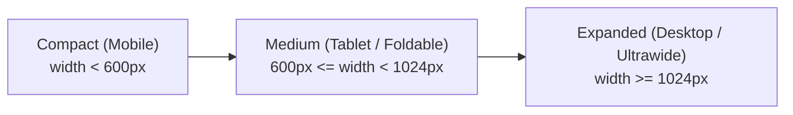

# 🎨 LET'S FLY TGR — Design System & UI Specification

**Application Name:** LET'S FLY TGR  
**Tagline:** *Study Together. Focus Better. Fly Higher.*  
**Design Philosophy:** Minimalist, High-Focus, Premium, Tactile, Modern Productivity  
**Reference Aesthetics:** Yeolpumta (functionality), Linear & Notion (typography & spacing), Spotify & Apple Fitness (visual feedback & rings)  

---

## 1. 🌈 Color System

The LET'S FLY TGR color palette is engineered for maximum legibility, reduced cognitive fatigue during intense study sessions, and distinct visual feedback. It features full dual-mode support (Light & Dark) with strict adherence to WCAG AA contrast standards (minimum 4.5:1 for body text, 3:1 for large text).

### 1.1 Brand Identity Colors

```
Primary (Deep Indigo)    : #4F46E5   rgb(79, 70, 229)
Primary Light            : #818CF8   rgb(129, 140, 248)
Primary Dark             : #3730A3   rgb(55, 48, 163)

Secondary (Emerald)      : #10B981   rgb(16, 185, 129)
Secondary Light          : #34D399   rgb(52, 211, 153)
Secondary Dark           : #047857   rgb(4, 120, 87)

Accent (Amber Flame)     : #F59E0B   rgb(245, 158, 11)
Accent Light             : #FBBF24   rgb(251, 191, 36)
```

### 1.2 Functional & Semantic Colors

| Purpose | Semantic Name | Light Mode Hex | Dark Mode Hex | Usage |
|:---|:---|:---:|:---:|:---|
| **Success** | `colorSuccess` | `#22C55E` | `#4ADE80` | Goal achieved, target met, streak saved |
| **Warning** | `colorWarning` | `#F97316` | `#FB923C` | Streak freeze warning, break expiring |
| **Error / Destructive** | `colorError` | `#EF4444` | `#F87171` | Emergency exit, session discard, error |
| **Information** | `colorInfo` | `#3B82F6` | `#60A5FA` | Announcements, tips, sync notices |
| **Active Focus** | `colorFocus` | `#6366F1` | `#818CF8` | Stopwatch running, live room active |
| **Break Mode** | `colorBreak` | `#06B6D4` | `#22D3EE` | Pomodoro rest interval |

### 1.3 Surface & Neutral Grayscale

```
Light Mode:
  Background             : #F8FAFC  (Slate 50)
  Surface                : #FFFFFF  (Pure White)
  Surface Elevated       : #FFFFFF  (White with Drop Shadow)
  Surface Variant        : #F1F5F9  (Slate 100)
  Border / Outline       : #E2E8F0  (Slate 200)
  Border Focused         : #4F46E5  (Primary)
  Text Primary           : #0F172A  (Slate 900)
  Text Secondary         : #475569  (Slate 600)
  Text Tertiary / Muted  : #94A3B8  (Slate 400)

Dark Mode:
  Background             : #090D16  (Deep Void Indigo)
  Surface                : #111827  (Gray 900)
  Surface Elevated       : #1E293B  (Slate 800)
  Surface Variant        : #1F2937  (Gray 800)
  Border / Outline       : #374151  (Gray 700)
  Border Focused         : #818CF8  (Primary Light)
  Text Primary           : #F8FAFC  (Slate 50)
  Text Secondary         : #CBD5E1  (Slate 300)
  Text Tertiary / Muted  : #64748B  (Slate 500)
```

---

## 2. 🔤 Typography System

The typography is built around **Inter** (via Google Fonts), engineered for exceptional clarity at both micro-labels (7-segment timer gauges) and monumental display metrics.

```
Display Large    : 57pt  / Line: 64pt  / Weight: 700 (Bold)       [Active Timer Stopwatch]
Display Medium   : 45pt  / Line: 52pt  / Weight: 700 (Bold)       [Dashboard Big Hours]
Display Small    : 36pt  / Line: 44pt  / Weight: 600 (SemiBold)   [Daily Totals]

Headline Large   : 32pt  / Line: 40pt  / Weight: 700 (Bold)       [Screen Hero Titles]
Headline Medium  : 28pt  / Line: 36pt  / Weight: 600 (SemiBold)   [Section Headers]
Headline Small   : 24pt  / Line: 32pt  / Weight: 600 (SemiBold)   [Card Titles]

Title Large      : 22pt  / Line: 28pt  / Weight: 600 (SemiBold)   [Modal Headers]
Title Medium     : 16pt  / Line: 24pt  / Weight: 600 (SemiBold)   [List Group Headers]
Title Small      : 14pt  / Line: 20pt  / Weight: 600 (SemiBold)   [Component Titles]

Body Large       : 16pt  / Line: 24pt  / Weight: 400 (Regular)    [Main Reading Text]
Body Medium      : 14pt  / Line: 20pt  / Weight: 400 (Regular)    [Standard Body, Descriptions]
Body Small       : 12pt  / Line: 16pt  / Weight: 400 (Regular)    [Captions, Timestamps]

Label Large      : 14pt  / Line: 20pt  / Weight: 500 (Medium)     [Buttons, Tabs, Chips]
Label Medium     : 12pt  / Line: 16pt  / Weight: 500 (Medium)     [Badges, Meta Tags]
Label Small      : 11pt  / Line: 16pt  / Weight: 500 (Medium)     [Micro Badges, Overlines]

Monospace Numbers: 
Font family configured with fontFeatures: [FontFeature.tabularFigures()] for jitter-free timer rendering.
```

---

## 3. 📐 Spacing & Layout Architecture

We employ a 4-point geometric spacing grid. Every margin, padding, height, and layout separation is an exact multiple of 4px.

```
space2   = 2.0px   // Micro padding (tag internal)
space4   = 4.0px   // Sub-unit (tight grouping)
space8   = 8.0px   // Small separation (icon-to-text)
space12  = 12.0px  // Compact element padding
space16  = 16.0px  // Standard layout gutter & card padding
space20  = 20.0px  // Relaxed container padding
space24  = 24.0px  // Large card separation
space32  = 32.0px  // Screen section separation
space40  = 40.0px  // Major layout block divider
space48  = 48.0px  // Hero section top/bottom padding
space64  = 64.0px  // Landing & Onboarding hero margins
```

### 3.1 Responsive Breakpoints



- **Compact (< 600px):** Single-column layout, bottom persistent navigation bar, bottom modal sheets.
- **Medium (600px – 1023px):** Two-column adaptive grid, collapsible navigation rail, centered floating dialogs.
- **Expanded (≥ 1024px):** Three-column layout (Left: Navigation Rail; Center: Primary Focus / Dashboard; Right: Live Friends & Group Activity), persistent header with profile stats.

---

## 4. 🔘 Shape, Radii & Elevations

### 4.1 Corner Radii
```
radiusXs    : 4.0px    // Micro indicators, tooltips
radiusSm    : 8.0px    // Form inputs, chips, small badges
radiusMd    : 12.0px   // Buttons, standard cards
radiusLg    : 16.0px   // Large containers, modal sheets
radiusXl    : 24.0px   // Hero feature cards, big dialogs
radiusFull  : 999.0px  // Pill buttons, avatars, progress rings
```

### 4.2 Elevation & Shadow Tokens (Material 3 Adaptive)
```
Shadow Level 0 : None (Flat borders)
Shadow Level 1 : 0px 1px 3px rgba(0, 0, 0, 0.08), 0px 1px 2px rgba(0, 0, 0, 0.04)   [Resting Cards]
Shadow Level 2 : 0px 4px 6px -1px rgba(0, 0, 0, 0.1), 0px 2px 4px -1px rgba(0,0,0,0.06) [Hovered Cards / FAB]
Shadow Level 3 : 0px 10px 15px -3px rgba(0, 0, 0, 0.12), 0px 4px 6px -2px rgba(0,0,0,0.05) [Dropdowns & Menus]
Shadow Level 4 : 0px 20px 25px -5px rgba(0, 0, 0, 0.15), 0px 10px 10px -5px rgba(0,0,0,0.04) [Modals & Dialogs]
```

---

## 5. 🧩 Reusable Component Library

### 5.1 Buttons (`AppButton`)
- **Primary:** Solid `#4F46E5` with `#FFFFFF` text. Subtle elevation on press. Used for primary calls-to-action (Start Study, Save, Confirm).
- **Secondary:** Semi-transparent emerald or primary tint (`#4F46E5` at 10% opacity) with colored text.
- **Outline:** 1.5px border (`#E2E8F0` Light / `#374151` Dark) with transparent background.
- **Destructive:** Rose fill (`#EF4444`) for critical actions (Emergency Exit, Delete Subject).
- **Timer Floating Action:** Monumental round circular button (72x72px) with animated ripple when active.

### 5.2 Input Controls (`AppTextField`)
- Rounded 12px corners with gentle 1.5px border.
- Floating label with clear focus indicator transitioning from subtle gray to Brand Primary `#4F46E5`.
- Integrated error shake animation and inline helper text.
- Password eye toggle and prefix/suffix icon slots.

### 5.3 Progress & Timer Rings (`TimerRingWidget`)
- Custom rendered painter utilizing sweep gradient shaders.
- Outer ring: Daily target progress (0% to 100%+ with gold celebration overflow).
- Inner ring: Current session duration gauge.
- Micro tick marks at 15-minute / 1-hour intervals for tactile feedback.

### 5.4 Subject Chip & Badges (`SubjectBadge`)
- Dynamic high-saturation subject dot accompanied by pastel tint background (`color.withOpacity(0.12)`).
- Iconography representing subjects (Book, Code, Calculator, Science, Art, Language).

---

## 6. 🎬 Motion & Animation Philosophy

Animations in LET'S FLY TGR must feel purposeful, snappy, and calm. We avoid distracting excessive bounces during deep work.

- **Standard Timing:**
  - Micro-interactions (hover, button press): `150ms` (`Curves.easeOutCubic`)
  - Screen transitions & dialog popups: `250ms` (`Curves.easeInOutCubic`)
  - Timer state transitions (start/pause/stop): `350ms` (`Curves.fastOutSlowIn`)
  - Celebration confetti / Milestone unlock: `800ms` (`Curves.elasticOut`)

- **Tactile Feedback:**
  - Subtle haptic feedback (`HapticFeedback.lightImpact()`) on timer start, pause, subject toggle, and button press.
  - Heavy warning haptic (`HapticFeedback.heavyImpact()`) when approaching blocklist limits or initiating emergency exit.

---

## 7. 📱 Key Screen Layout Architectures

### 7.1 Home / Dashboard
- **Top Bar:** Greeting, current study streak badge (e.g. `🔥 7 Days`), notifications bell with unread dot, user avatar.
- **Hero Focus Card:** Massive current day total study time (e.g. `05:42:19`), daily target circular ring, "Start Studying" high-priority button.
- **Active Subject Carousel:** Quick-select subject pill selector with one-tap start.
- **Peer Live Strip:** Horizontal scrolling avatar list of online friends and group members currently in deep focus.
- **Weekly Trend Mini-Chart:** 7-bar mini-graph displaying study distribution over the last 7 days.

### 7.2 Study Timer Screen (Deep Focus Mode)
- **Minimalist Immersion:** Ability to toggle "Full Immersion" mode which dims all distracting UI elements.
- **Central Timer:** Monumental tabular numbers (`00:00:00`) with smooth millisecond or second ticker.
- **Subject Header:** Currently active subject badge with target progress indicator.
- **Controls Dock:** Glassmorphic floating control dock at bottom with Pause, Resume, Stop, and Note Attachment buttons.
- **Focus Shield Status:** Pill indicator showing "Shield Active — 14 Distracting Apps Blocked".

### 7.3 Groups & Social Room
- **Group Info Header:** Group name, member count, collective study hours today.
- **Live Room Grid:** Responsive card grid showing each member's current status:
  - 🟢 Studying (with active subject and live elapsed session time)
  - 🟡 On Break (with break timer countdown)
  - ⚪ Offline (with last active timestamp)
- **Group Chat & Announcements:** Pinned coordinator announcements and motivational notices.

---

## 8. 🌙 Dark Mode & AMOLED Theme Execution

Given that serious study sessions frequently occur late at night, Dark Mode is treated as a first-class citizen rather than an afterthought:
- Background is set to ultra-low luminance `#090D16` to prevent OLED power drain while maintaining rich color depth.
- Card surfaces feature subtle 1px border luminance `#1F2937` to maintain boundary definition without high contrast glare.
- Timer numbers use high-legibility crisp white `#F8FAFC` paired with softened brand accents.
