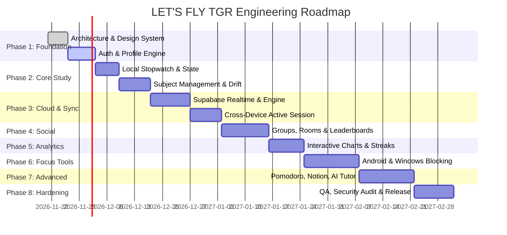

# 🗺️ LET'S FLY TGR — Development Roadmap & Execution Strategy

**Project:** LET'S FLY TGR  
**Tagline:** *Study Together. Focus Better. Fly Higher.*  
**Target Platforms:** Android, Windows 10/11 (Future Web)  
**Architecture:** Offline-First Clean Architecture (Flutter + Riverpod + Supabase + Drift/SQLite)  
**Version:** 1.0.0-alpha  

---

## 🎯 Executive Overview

This roadmap defines the end-to-end engineering lifecycle for **LET'S FLY TGR**, outlining 8 structured development phases from initial foundation through global public release. Each phase contains clear deliverables, technical dependencies, risk mitigations, acceptance criteria, and testing milestones.

---

## 📋 Phase Breakdown

### Phase 1: Foundation, Design System & Authentication (Current)
**Timeline:** Weeks 1–3  
**Status:** In Progress  

#### Objectives
Establish the foundational infrastructure, strict linting rules, cross-platform design tokens, responsive scaffolding, and Supabase authentication with profile onboarding.

#### Deliverables & Task Checklist
- [x] Workspace & environment assessment (Flutter, Dart, Android SDK, Visual Studio)
- [x] Architecture specification (`ARCHITECTURE.md`)
- [x] Database & RLS migration design (`DATABASE_SCHEMA.md`)
- [x] Security policies & threat model (`SECURITY.md`)
- [x] Project README & developer guidelines (`README.md`)
- [x] Development roadmap (`DEVELOPMENT_ROADMAP.md`)
- [x] Design system specification (`DESIGN_SYSTEM.md`)
- [ ] Base Flutter project setup with dependencies (`pubspec.yaml`, `analysis_options.yaml`)
- [ ] Design token implementation (Colors, Typography, Spacing, Shadows, Theme)
- [ ] Core utilities (Validators, Context extensions, Responsive layout builders, Exceptions)
- [ ] GoRouter navigation infrastructure with Auth-state redirection
- [ ] Shared reusable UI component library (Buttons, TextFields, Cards, Avatars, Loaders)
- [ ] Supabase Client singleton and Auth repository interface
- [ ] Riverpod `AuthController` and `AuthState` implementation
- [ ] Auth UI: Animated Splash screen
- [ ] Auth UI: 3-step Onboarding walkthrough
- [ ] Auth UI: Login screen (Email/Password, Google OAuth, Phone OTP trigger)
- [ ] Auth UI: Registration screen with strength validation
- [ ] Auth UI: Forgot Password & Reset screen
- [ ] Auth UI: Initial Profile Setup screen (Username, Display Name, Avatar picker)

#### Key Dependencies & Risks
- **Dependency:** Supabase project provisioning and OAuth provider credential registration.
- **Risk:** Google OAuth on Windows requires deep linking protocol handling (`app://callback` or loopback HTTP server).
- **Mitigation:** Implement custom URL scheme registration in Windows desktop runner (`windows/runner/main.cpp`) alongside loopback port fallback.

---

### Phase 2: Core Study Timer & Subject Management
**Timeline:** Weeks 4–6  
**Status:** Planned  

#### Objectives
Build an offline-capable, glitch-free study timer engine (Stopwatch mode) with subject categorization, daily study aggregation, and local persistence via Drift (SQLite).

#### Deliverables & Task Checklist
- [ ] Drift (SQLite) database schema definition with local code generation
- [ ] Subject CRUD operations with color picker, iconography, and target hours
- [ ] Local Stopwatch engine with high-precision monotonic ticker (`Stopwatch`)
- [ ] Background service execution integration (Android Foreground Service with ongoing notification)
- [ ] Subject-wise time tracking and pause/resume lifecycle management
- [ ] Session cancellation vs. session commit workflows
- [ ] Daily study total calculation with timezone boundary handling (e.g. 4:00 AM day rollover)
- [ ] Local history view with day, week, and month aggregations
- [ ] Unit tests for timer drift calculation and timezone rollover logic

#### Key Dependencies & Risks
- **Risk:** Operating system aggressive battery optimizations killing background timer on Android (Doze mode, vendor task killers).
- **Mitigation:** Android Foreground Service with `FOREGROUND_SERVICE_SPECIAL_USE` permission, wakelock management during active sessions, and monotonic timestamp delta calculation on resume.

---

### Phase 3: Cloud Synchronization & Cross-Device Active Sessions
**Timeline:** Weeks 7–9  
**Status:** Planned  

#### Objectives
Integrate Supabase Cloud backend with bidirectional offline-first sync. Implement server-authoritative active session tracking so starting on Windows reflects live on Android and vice-versa.

#### Deliverables & Task Checklist
- [ ] Supabase database migrations applied (`00001` through `00014`)
- [ ] Bidirectional sync repository using Drift change-tracking and Supabase upserts
- [ ] `active_sessions` server-authoritative state engine
- [ ] Heartbeat ping mechanism (30-second interval via WebSocket or edge function)
- [ ] Stale session detection and auto-termination cleanup cron/worker
- [ ] Cross-device session takeover / duplicate conflict resolution modal
- [ ] Supabase Realtime channel subscription for active study state
- [ ] Offline queue: buffering completed sessions in SQLite and flushing on network reconnect
- [ ] Comprehensive RLS security testing against unauthorized session hijacking

#### Key Dependencies & Risks
- **Risk:** Clock skew between client devices and Supabase server causing inaccurate recorded durations.
- **Mitigation:** Server-calculated durations based on `NOW()` vs. `started_at` in database triggers, synchronized NTP offsets on client init.

---

### Phase 4: Social Engine, Groups, Live Rooms & Leaderboards
**Timeline:** Weeks 10–12  
**Status:** Planned  

#### Objectives
Introduce social accountability: study groups, 6-character invite codes, live virtual study rooms showing real-time peer status, and multi-tier leaderboards.

#### Deliverables & Task Checklist
- [ ] Group creation, configuration, privacy controls (Public vs. Private), and avatar upload
- [ ] Unique 6-character alphanumeric group invite code generator and join resolver
- [ ] Friend request system (Send, Accept, Reject, Block, Unfriend)
- [ ] Live Study Room UI: Real-time grid of members studying right now with active subject badges
- [ ] Supabase Presence integration for low-latency live member state broadcast
- [ ] Leaderboard engine: Daily, Weekly, Monthly, and All-Time rank calculations
- [ ] Group-internal leaderboards vs. Friends vs. Global leaderboards
- [ ] Privacy filter controls (Hide study details, Anonymous rank, Ghost mode)
- [ ] Real-time study notifications ("Alex just started studying Organic Chemistry")

#### Key Dependencies & Risks
- **Risk:** High concurrent presence broadcasts causing Supabase Realtime channel throttling in large groups.
- **Mitigation:** Presence throttling (debounce state changes to max once every 15s), pagination of active room participants (top 50 active).

---

### Phase 5: Analytics, Gamification & Push Notifications
**Timeline:** Weeks 13–15  
**Status:** Planned  

#### Objectives
Transform raw study logs into actionable productivity insights with interactive FL Chart visualisations, streak tracking, unlockable achievements, and scheduled push reminders.

#### Deliverables & Task Checklist
- [ ] Analytics dashboard: Daily breakdown bar chart, weekly comparison graph, subject distribution pie chart
- [ ] Peak productivity heatmap (Hour-of-day vs. Day-of-week matrix)
- [ ] Study streak engine: Calculation of current streak, longest streak, and rest-day freezes
- [ ] Achievements engine: Dynamic unlocking of milestones (First 10 Hours, 7-Day Streak, Night Owl, etc.)
- [ ] Push Notification service integration (Firebase Cloud Messaging + Supabase Edge Functions)
- [ ] Customizable user notification preferences (Daily target reminder, Inactivity alerts, Streak warnings)
- [ ] Weekly progress summary generator and exportable study report card

---

### Phase 6: Distraction Blocking & Focus Enforcement
**Timeline:** Weeks 16–18  
**Status:** Planned  

#### Objectives
Build transparent, opt-in focus enforcement for Android and Windows. Respect privacy and OS guidelines while providing robust distraction shielding during active study.

#### Deliverables & Task Checklist
- [ ] **Android Native Integration (Kotlin):**
  - [ ] `UsageStatsManager` permission workflow and detection service
  - [ ] App blocklist selector UI (fetching installed packages excluding system essentials)
  - [ ] Foreground blocking overlay (`SYSTEM_ALERT_WINDOW`) displaying motivational intervention
  - [ ] Strict Mode vs. Soft Mode (Strict blocks navigation; Soft offers a 60-second break option)
  - [ ] Emergency Exit with cooldown timer and study session penalty
- [ ] **Windows Native Helper (C# / Win32):**
  - [ ] Background process monitor tracking active window foreground handle (`GetForegroundWindow`, `GetWindowThreadProcessId`)
  - [ ] Windows blocklist configuration and process minimization / focus restoration
  - [ ] Focus status synchronization over local IPC named pipe to Flutter desktop client
- [ ] Comprehensive user consent disclosures and ethical focus pledge

#### Platform Limitations & Technical Risks
- **Android:** Modern Android restrictions (API 34+) heavily restrict background service launches and overlays. `AccessibilityService` is reserved only for accessibility needs under Google Play policies. Therefore, implementation utilizes `UsageStatsManager` with transparent foreground notifications.
- **Windows:** Anti-virus software might flag low-level keyboard/mouse hooks. Implementation strictly uses standard Win32 user-space foreground polling without root/kernel drivers.

---

### Phase 7: Advanced Productivity (Pomodoro, Notion & AI Assistant)
**Timeline:** Weeks 19–21  
**Status:** Planned  

#### Objectives
Augment the study workflow with multi-mode Pomodoro cycles, official Notion integration for lecture note synchronization, and an AI-powered tutor.

#### Deliverables & Task Checklist
- [ ] **Pomodoro Engine:**
  - [ ] Classic (25/5), Extended (50/10), Deep Work (90/15), and Custom interval configurations
  - [ ] Automatic audio chime transitions and vibration cues
  - [ ] Long break intervals after completion of 4 cycles
- [ ] **Notion Workspace Integration:**
  - [ ] Official OAuth 2.0 flow for Notion public integrations
  - [ ] Workspace page browser & authorized database selector
  - [ ] Auto-link study sessions to specific Notion lecture pages
  - [ ] Create quick study notes from within the app and append directly into Notion
- [ ] **AI Study Assistant (Gemini / Anthropic / OpenAI abstraction):**
  - [ ] Secure Edge Function proxy (Client never holds backend AI keys)
  - [ ] "Explain Concept Simply" conversational study bot
  - [ ] Automated MCQ & Flashcard generation from uploaded study notes
  - [ ] Daily AI study plan generator based on upcoming targets and past weaknesses
  - [ ] Token usage quota tracking (`ai_usage` table) to prevent billing overruns

---

### Phase 8: Hardening, Security Audits & Public Store Release
**Timeline:** Weeks 22–24  
**Status:** Planned  

#### Objectives
Rigorous automated testing, security penetration review, memory profiling, accessibility verification, and building signed production binaries for Google Play and Microsoft Store.

#### Deliverables & Task Checklist
- [ ] End-to-end integration tests using `integration_test`
- [ ] Supabase RLS security audit with automated multi-user privilege escalation tests
- [ ] Memory leak profiling on long-running study sessions (12+ hours continuous)
- [ ] Performance tuning: Flutter frame rendering profiling (consistently maintaining 60/120 FPS)
- [ ] Accessibility audit: Contrast ratios, screen reader semantics (`Semantics` widgets), font scaling
- [ ] Production build pipelines:
  - [ ] Android App Bundle (`.aab`) with ProGuard/R8 shrinking and release keystore signing
  - [ ] Windows MSIX package generation with developer certificate signing
- [ ] Google Play Console store listing, privacy policy, and Data Safety form preparation
- [ ] Microsoft Store submission packaging

---

## 🛡️ Technical Risks & Mitigation Matrix

| Risk Domain | Risk Description | Severity | Likelihood | Engineered Mitigation |
|:---|:---|:---:|:---:|:---|
| **Timer Integrity** | Device sleep / OS killing app resets elapsed timer. | High | High | Monotonic timestamp storage (`DateTime.now() - session.startedAt - totalPausedMs`) verified against server timestamps. |
| **Cross-Device Sync** | Concurrent active sessions started on Phone & Desktop simultaneously. | High | Medium | Supabase database trigger rejects new active session if one with matching `user_id` is less than 60s stale. |
| **Play Store Policy** | Google Play rejecting app due to Accessibility or Package Usage permissions. | Critical | Medium | Use strictly standard `PACKAGE_USAGE_STATS` with an upfront, prominent full-screen disclosure explaining educational focus utility. |
| **AI Cost Overrun** | Malicious users spamming AI study assistant API endpoints. | Medium | High | Supabase Edge Function rate limiting (Tiered: 20 queries/day for free users), cached responses in Redis/Supabase. |
| **Network Partition** | Student studying on a subway / offline for hours. | Medium | High | Local Drift SQLite database stores all session slices with status `pending_sync`. Sync engine syncs sequentially when online. |

---

## 🚦 Release Gates & Definition of Done

Each feature must satisfy the following criteria before merging into `main`:
1. **Architecture Compliance:** Layer separation strictly respected (No Supabase client calls inside presentation widgets).
2. **State Management:** Riverpod providers cleanly scoped with auto-dispose where appropriate.
3. **Test Coverage:** Unit tests present for business logic & reducers; zero regression on existing suites.
4. **Platform Compatibility:** Tested and verified on both an Android physical device/emulator and a Windows 10/11 desktop window.
5. **Security Validation:** All associated database tables enforce non-bypassable Row Level Security policies.
6. **Design Fidelity:** UI strictly matches design tokens, spacing scales, and supports both Dark & Light themes cleanly.
